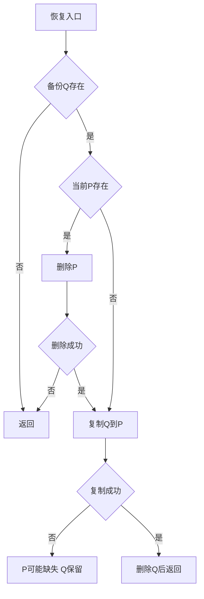
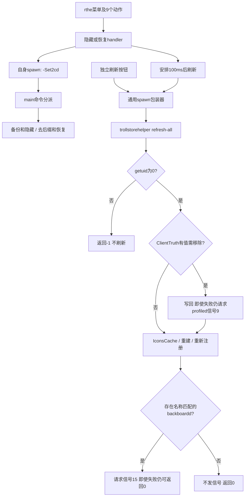
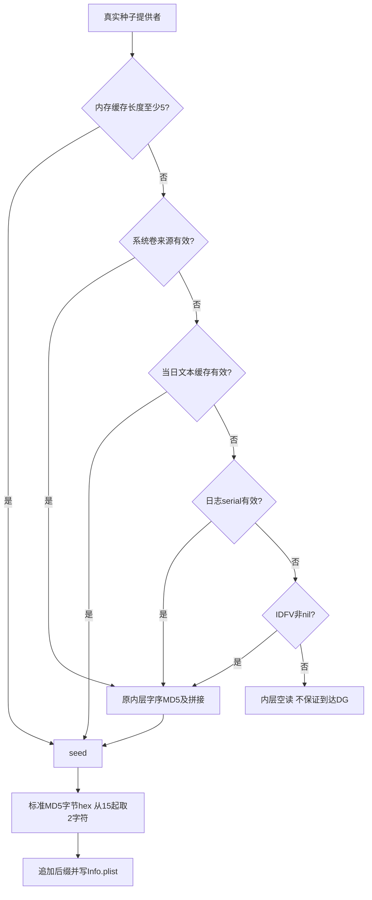

# DGAssistant 隐藏与恢复：调用参数及失败路径复核

> 2026-10-16；IDA `127.0.0.1:13346`。样本 SHA-256：`1f39b8894177d709c1c1b7b9dc76bbd8e70cfb3a9f5940e5a536edf1a4116139`。
> 原报告保存在 `work/dgassistant-byte-audit/evidence/HIDE_RESTORE_MECHANISM.before-paths.md`。本报告基于原指令回放及磁盘/IDA字节核验，不继承旧的“全部完全确认”。
> 第三轮已补齐按钮、子进程、刷新与注销链，见 §9；修改前版本另存为 `HIDE_RESTORE_MECHANISM.before-control.md`。提权参数不等于实际获得root，系统API副作用均为离线模型验证。
> 第四轮已取消关键路径的固定seed替身，追清多源来源、字序及空指针分支，见 §10；当前修订前版本为 `HIDE_RESTORE_MECHANISM.before-seed-process.md`。

## 1. 这次确认了什么

隐藏核心是给 Bundle ID **追加**两位后缀、删除两个 scheme 字段并写回 Info.plist；截去末两位属于独立的撤销后缀函数。备份、隐藏、去后缀和恢复各有独立函数入口，旧报告将多个函数合并并把方向写反。

恢复是：找到 `.bak` → 如现有 Info.plist 存在则先删除 → 复制 `.bak` 成 Info.plist → 复制成功才删除 `.bak`。它不是原子替换；删除成功、复制失败的路径会暂时失去 Info.plist，但保留备份。

第二轮31个核心用例、第三轮60个按钮/进程/helper用例分别覆盖清理与隐藏子系统；Foundation文件操作采用显式内存模型，原始ARM64/CFF控制流在Unicorn中执行。报告中的“成功/失败”文件状态是模型结果，未在设备上破坏或恢复任何应用。每次API调用的真实代码地址、寄存器和分支记录均保留。

## 2. 独立入口及参数

| 地址 | 参数 | 已验证职责 |
|---|---|---|
| `0x1000E0B34` | 内部调用 seed 提供函数 | 生成用于 Bundle ID 的二字符后缀 |
| `0x1000E1444` | X0=bundleDir | 读取 Info.plist，追加后缀、删两个 scheme 字段、写回 |
| `0x1000E1F58` | X0=bundleDir | 匹配后缀后截去2字符，写回；不补回丢掉的scheme |
| `0x1000E2C80` | X0=路径字符串 | `stringByDeletingLastPathComponent`，返回父目录；不是扫描查找 .app |
| `0x1000E30A0` | X0=bundleDir | 原文件存在且.bak不存在时创建整份备份 |
| `0x1000E34E0` | X0=bundleDir | 先删当前 Info，再从.bak复制恢复，成功后删.bak |

上层直接调用锚点：`0x1002D5004` 调备份；`0x1002E1CF4` 调隐藏；`0x1002D1830` 调去后缀；`0x1002D18C0` 调恢复。这些点前面先调父目录函数。第三轮已从main及真实argv分别回放，闭合隐藏命令“先备份、再隐藏”和恢复命令“先去后缀、再整份恢复”的路径；该先后关系不是凭地址相邻推断，见 §9.2。

## 3. 路径及明文来源

设 B 为调用方传入的 bundleDir：

```text
P = B.stringByAppendingPathComponent("Info.plist")
Q = P.stringByAppendingString(".bak")
```

核心函数没有把 B 固定成某个 UUID。运行时调用方决定 `<UUID>/<App>.app`；本轮回放输入为 `/fixture/Target.app`，该名字只是测试数据。

原始 CFString 对象及其 backing bytes 均已从磁盘解码：

| CFString VA | 内容 |
|---|---|
| `0x100C41D18` | `Info.plist` |
| `0x100C41D98` | `.bak` |
| `0x100C41D38` | `CFBundleIdentifier` |
| `0x100C41D58` | `CFBundleURLTypes` |
| `0x100C41D78` | `LSApplicationQueriesSchemes` |

`path-byte-verification.json` 记录各对象32字节结构、backing指针、文件偏移、原始文本十六进制；不将IDA绑定后的isa误当磁盘isa。

## 4. 备份：检查的是两个不同路径

在 `0x1000E30A0` 入口开始的完整回放中：

1. `0x1000E32E4` 的 `fileExistsAtPath:`，X2=X19=P，即 **Info.plist**。
2. 原文件存在后，`0x1000E333C` 的检查，X2=X20=Q，即 **Info.plist.bak**。
3. 备份不存在时，在 `0x1000E3390` 调 `copyItemAtPath:toPath:error:`：X0=file manager，X2=P，X3=Q，X4=NSError输出指针。

因此旧文档把 `0x1000E3194` 一带生成Q后紧接着的检查认成“检查Q”不成立：X2实际仍取X19=P。路径构造和实际参数寄存器必须一起看。

已验证分支：源缺失不复制；备份已存在不覆盖；复制失败不创建备份；复制成功得到与原字典内容相同的Q。代码采用普通文件复制，没有在这条复制路径加密内容。

## 5. 隐藏：追加后缀，而不是截去后缀

`0x1000E1444` 检查P存在并读取可变字典，取 `CFBundleIdentifier`；成功路径调用后缀生成函数，然后：

- `0x1000E18A0`：`stringByAppendingString:`，receiver=原Bundle ID，X2=后缀。
- `0x1000E18CC`：`setObject:forKeyedSubscript:`，X2=拼接结果，X3=`CFBundleIdentifier`。
- `0x1000E1F44`：`removeObjectForKey:@"CFBundleURLTypes"`。
- `0x1000E1ECC`：`removeObjectForKey:@"LSApplicationQueriesSchemes"`。
- `0x1000E1E58`：`writeToFile:P atomically:YES`，X0=修改后字典、X2=P、W3=1。

非nil seed路径，后缀函数对 `sub_1005146EC` 返回字符串做MD5、按 `%02x`拼成十六进制，并在 `0x1000E13B4` 取 `substringWithRange:(15,2)`。第二轮隔离用例的固定 `fixture-device-seed`产生4d；第四轮已实际执行种子提供者、后缀和隐藏入口，不再用固定返回值证明来源，见 §10。外层收到nil时存在DG分支，但提供者内部可能先空读，不能把DG写成全流程可靠兜底。

合成输入 `org.fixture.Target` 变成 `org.fixture.Target4d`。再次调用变成 `org.fixture.Target4d4d`，本入口自身没有保证追加操作幂等。调用方是否额外阻止重复触发，不能由本入口推断。

同一字典中的 `CFBundleDisplayName="Fixture"` 及无关字段 `Keep` 保留。旧报告把 `0x10010AB90` 的显示名读取/比较解释为此隐藏核心会改显示名，没有建立写入数据流；不能继续写成该入口的副作用。

## 6. 去后缀与整份恢复是两种操作

### 6.1 去后缀入口 0x1000E1F58

该函数先用 `hasSuffix:` 检查后缀，命中后 `length` 减2（原指令 `0x1000E24BC`），再 `substringToIndex:`，写回Bundle ID。匹配 `...4d` 的回放去掉末2字符；不匹配的 `...ZZ` 未改变。

它没有凭空恢复 schemes，整份参数还原依赖 `.bak`。原文把这一段作为“隐藏时砍两位”应撤回。

### 6.2 整份恢复入口 0x1000E34E0

按实际BR派发的执行顺序：

| 阶段/调用点 | selector | 参数及条件 |
|---|---|---|
| `0x1000E37BC` | `fileExistsAtPath:` | X2=Q；无备份则返回 |
| `0x1000E3BE4` | `fileExistsAtPath:` | X2=P；判断是否先删除当前文件 |
| `0x1000E3894` | `removeItemAtPath:error:` | X2=P，X3=NSError指针；删除失败不继续复制 |
| `0x1000E3DD4` | `copyItemAtPath:toPath:error:` | X2=Q，X3=P，X4=NSError指针；另有等价复制块0x1000E3D34 |
| `0x1000E3C64` | `removeItemAtPath:error:` | 复制成功后X2=Q，X3=0；清理备份 |

注意：`0x1000E3C64` 地址小于复制块地址，执行顺序仍是**先复制再删备份**；按地址顺序拼反汇编会产生错误结论。

| 用例 | 结果 |
|---|---|
| P/Q均存在，操作成功 | P为Q的原始内容，Q删除 |
| P缺失，Q存在 | 直接复制Q→P，再删除Q |
| Q缺失 | P不变 |
| 删除P失败 | P/Q均保留，无复制 |
| 删除P成功、复制失败 | P缺失，Q仍存在 |

该函数在模型中的成功返回值为0，删除/复制失败路径返回1，无备份用例返回2；不能把其返回值当作 Foundation `BOOL success` 正向解释。

## 7. 注册刷新：由命令线索补为完整进程链

磁盘上确有 `trollstorehelper`（CFString `0x100C41798`）和 `refresh-all`（`0x100C41838`）。在 `0x1000AD454` 装载 `refresh-all`，构成单元素NSArray；`0x1000AD498` 调 `sub_1000A8D50`，X0=拼接得到的helper路径，X1=该参数数组、X2=X3=0。

第二轮只确认了上述命令构造。第三轮已另行执行实际按钮回调中的刷新链，以及随包helper的原始 `refresh-all` 分支：UID=0后最终向名称匹配 `backboardd` 的进程提交SIGTERM(15)。注册和信号失败分支也已验证，见 §9；不能再把这部分笼统降级为“只有字符串线索”。这仍不是设备已注销、所有App已注册成功或“环境检测全绿”的实测证明。

历史 `child.log` 首行记录过 `DGAssistant -Set2cd 隐藏程序 com.tigisoftware.Filza 2` 的提交；不能单凭argv证明子进程有效UID、所有文件操作成功或注销完成。

## 8. 原始字节与复现

| VA | 文件偏移 | 原始字节 | 解码 |
|---|---|---|---|
| `0x1000e32e4` | `0xe32e4` | `7d202a94` | `bl #0x100b6b4d8` |
| `0x1000e333c` | `0xe333c` | `67202a94` | `bl #0x100b6b4d8` |
| `0x1000e3390` | `0xe3390` | `52202a94` | `bl #0x100b6b4d8` |
| `0x1000e18cc` | `0xe18cc` | `03272a94` | `bl #0x100b6b4d8` |
| `0x1000e1f44` | `0xe1f44` | `65252a94` | `bl #0x100b6b4d8` |
| `0x1000e1ecc` | `0xe1ecc` | `83252a94` | `bl #0x100b6b4d8` |
| `0x1000e1e58` | `0xe1e58` | `a0252a94` | `bl #0x100b6b4d8` |
| `0x1000e24bc` | `0xe24bc` | `020800d1` | `sub x2, x0, #2` |
| `0x1000e3894` | `0xe3894` | `111f2a94` | `bl #0x100b6b4d8` |
| `0x1000e3dd4` | `0xe3dd4` | `c11d2a94` | `bl #0x100b6b4d8` |
| `0x1000e3c64` | `0xe3c64` | `1d1e2a94` | `bl #0x100b6b4d8` |
| `0x1000e13b4` | `0xe13b4` | `49282a94` | `bl #0x100b6b4d8` |

证据目录：`work/dgassistant-byte-audit/evidence/`。`path-fixtures.json` 含每用例输入/结果、调用点原始寄存器和全部BR目标；`path-byte-verification.json` 含上述字节与CFString；`tail-path-data.json` 含helper命令构造与上层直接调用；哈希索引为 `manifest.sha256`。

```sh
python3 work/dgassistant-byte-audit/run_path_checks.py
python3 work/dgassistant-byte-audit/verify_paths.py
```



## 9. 第三轮：按钮到文件核心、refresh-all与注销

### 9.1 菜单与实际回调

`-[ViewController rthe]` `0x1003BA1FC` 通过校验continuation `0x1003BA4D0` 派发菜单构造块 `0x1003BB2B8`；UIKit构造代码在 `0x1003BC...`。原指令回放记录了按钮文字、捕获的block原始字节、invoke指针及实际参数，不靠方法名猜功能。

| 按钮 | handler入口 | 提交的目标 |
|---|---|---|
| 隐藏Filza特征 | `0x1003BDC30` | `com.tigisoftware.Filza` |
| 恢复Filza特征 | `0x1003BEA80` | Filza ID加当前后缀 |
| 隐藏巨魔和TrollFools特征 | `0x1003BF6D4` | TrollStore、TrollInstallerX、TrollFools |
| 恢复巨魔和TrollFools特征 | `0x1003C0948` | 上述三个ID分别加后缀 |
| 隐藏Sileo和插件转换特征 | `0x1003C1540` | SileoStore、roothide.patcher |
| 恢复Sileo和插件转换特征 | `0x1003C1E58` | 上述两个ID分别加后缀 |
| 隐藏全部程序特征 | `0x1003C2E18` | 下列8个固定ID |
| 恢复全部程序特征 | `0x1003C42B8` | 下列8个ID分别加后缀 |
| 刷新程序 | `0x1003C72B8` | 只提交helper刷新，不提交隐藏/恢复命令 |

“全部”的8个ID及顺序为：`com.opa334.TrollStore`、`com.Alfie.TrollInstallerX`、`com.opa334.Dopamine-roothide`、`com.tigisoftware.Filza`、`com.roothide.manager`、`wiki.qaq.TrollFools`、`org.coolstar.SileoStore`、`com.roothide.patcher`。因此不能写成“枚举隐藏所有已安装程序”。

### 9.2 自身子进程与中央命令分派

按钮回调调用 `sub_1001001DC`，隐藏全部的一条原始调用点为 `0x1003C300C`。启动器的内部块 `0x100100804` 构成以下argv；B是本App运行时包目录，并不是磁盘解包路径：

```text
隐藏: [B/DGAssistant, -Set2cd, 隐藏程序, 原bundleID, 2, NULL]
恢复: [B/DGAssistant, -Set2cd, 恢复程序, 带后缀bundleID, 2, NULL]
```

在 `0x10010124C` 调 `posix_spawn(pid*, executablePath, NULL, attr*, argv, NULL)`；在 `0x100100F88` 调 `waitpid(pid,&status,0)`。恢复Filza的模型argv为 `com.tigisoftware.Filza4d`；`4d`来自明确标记的fixture seed，不是宣称所有设备均用此后缀。

子进程从main `0x1002C2D6C` 读取argc/argv并进入中央CFF：

| 命令 | bundle解析/路径来源 | 已走通的文件核心顺序 |
|---|---|---|
| 隐藏程序 | `0x1002CF480` 取 `applicationProxyForIdentifier:`；`canonicalExecutablePath`后取父目录 | `0x1002D5004` → `sub_1000E30A0`备份；`0x1002E1CF4` → `sub_1000E1444`隐藏 |
| 恢复程序 | `0x1002D2518` 按带后缀ID取proxy；同样从canonicalExecutablePath取父目录 | `0x1002D1830` → `sub_1000E1F58`去后缀；`0x1002D18C0` → `sub_1000E34E0`整份恢复 |

在main级用例中，备份copy失败后仍继续隐藏；隐藏write失败后main仍返回0；恢复copy失败导致P缺失而Q保留，main仍返回0。恢复无Q时，前面的去后缀仍可能修改P，但无法补回被删的schemes。末项 `"2"` 换成 `"0"`、`"1"`、`"text"` 的隐藏用例仍进入同一文件路径；本链不能把它解释为注销开关。

### 9.3 提权请求与两种失败处理

| 调用点（主程序VA） | 实参 |
|---|---|
| `0x100100D08` | `posix_spawnattr_set_persona_np(attr,99,1)` |
| `0x100100D14` | `posix_spawnattr_set_persona_uid_np(attr,0)` |
| `0x100100D20` | `posix_spawnattr_set_persona_gid_np(attr,0)` |
| `0x100101534` | `posix_spawnattr_setpgroup(attr,0)` |
| `0x100101540` | `posix_spawnattr_setflags(attr,2)` |

上述接口返回失败不会提前阻断spawn。**请求UID/GID=0不是子进程已获得root的证据**。自身启动器还忽略spawn的返回码：注入返回13、不写入新PID时，原代码随后调用 `waitpid(0,&status,0)`；wait返回-1、子进程退出7或被信号9终止，也不阻断父层刷新。

刷新使用另一包装器 `sub_1000A8D50`，不能混为同一种错误处理：它在 `0x1000AB020` spawn失败后返回错误码、不wait；在 `0x1000A9EC0` waitpid=-1时打印perror并返回-222（W0=`0xFFFFFF22`），EINTR亦不重试。正常raw status=`0x0700`被提取为7，但raw status=9被提取成0；不能把0等同“子进程正常成功退出”。父层没有据这些返回值阻断后续loading结束。

### 9.4 刷新的触发点及真实helper行为

隐藏Filza回调在 `0x1003BDFF8/0x1003BE00C` 以100,000,000ns安排 `sub_1003AD518`；隐藏全部对应 `0x1003C30A8/0x1003C30BC`。该块构成单元素数组 `[@"refresh-all"]`，以本包路径拼出 `trollstorehelper`，在 `0x1003AE854`（另一等价块 `0x1003AEA0C`）调用通用启动器，X2=X3=0。自身操作成功与否未形成刷新前置条件。

独立“刷新程序”按钮先设置activity，再通过 `0x1003C7D2C` 派发 `sub_1003C7E1C`；该块在 `0x1003C8340`（另一块 `0x1003C8170`）提交同一helper命令。这些路径结束时调用 `TSPresentationDelegate stopActivityWithCompletion:`；其完成回调只有日志，不是注销接口。

以下地址均属于**随包helper**，不是主程序。helper SHA-256为 `1c3bc999bae2e8f735a10421ccea2689d6633a5a7cae4ffba06e66094af39cc9`：

1. main `0x100201C10`：argc至少2；`0x100201C58`调用getuid，非0先返回-1，不走刷新或kill。
2. `0x100201EAC`比较首命令为 `refresh-all`，命中后调用 `_cleanRestrictions`；其条件文件副作用见下一节。
3. `0x100201EDC`请求删除 `/var/containers/Shared/SystemGroup/systemgroup.com.apple.lsd.iconscache/Library/Caches/com.apple.IconsCache`，error=NULL；不存在或删除失败不阻断流程。
4. `0x100201F0C`调用 `_LSPrivateRebuildApplicationDatabasesForSystemApps:internal:user:`，三个BOOL参数均为1；返回NO仍继续。
5. `_shouldRegisterAsUserByDefault`在本样本 `0x100205058`只有 `MOV W0,#0; RET`，所以 `0x100201F24`总会在该分支调用 `_refreshAppRegistrations(1)`。它先处理TrollStore包，再遍历TrollStore安装包路径列表，不等同遍历全部已安装App。
6. `_registerPath`的原始回放中，有Info/BID时在 `0x1002038CC`提交 `registerApplicationDictionary:`，含Path、CFBundleIdentifier及 `ApplicationType=System`；缺少Info/BID时可在 `0x1002039B0`走 `unregisterApplication:`。API返回NO会向上传回0，但刷新遍历不据此停止。
7. `0x100201F34`调用 `_killall(@"backboardd",1)`。进程发现结果先取lastPathComponent，与 `backboardd`作字符串相等比较；`0x100205C8C`在该flag=1时选择信号15，`0x100205CA0`尾跳到 `_kill(pid,15)`。无名称匹配/进程列表为空则不发信号；kill=-1仍可在 `0x100201FF4`走返回0路径。

这条注销请求的实现是终止backboardd，不是主程序直接调用 `_respring` 杀SpringBoard。helper虽另有 `_respring` 函数，但本条命令没有走它。

### 9.5 ClientTruth的条件副作用

`_cleanRestrictions`读取：

```text
/private/var/containers/Shared/SystemGroup/systemgroup.com.apple.configurationprofiles/Library/ConfigurationProfiles/ClientTruth.plist
root["com.apple.lsd.appremoval"]["clientRestrictions"]["union"]["removedSystemAppBundleIDs"]["values"]
```

文件/中间字典缺失或values为空时跳过修改。存在列表时，原代码以options=2反向枚举：对每个bundle检查 `/System/Library/AppSignatures/<bundle>`；该文件存在则保留，不存在则从可变列表移除。只有确有移除时才深复制根plist、替换上述values，并在helper `0x1002003C8`调用 `writeToURL:error:`，error=NULL。

随后在 `0x1002003D8`调用 `_killall(@"profiled",0)`；同一原始信号选择器在flag=0时选择9（SIGKILL）。新增用例同时验证两个待移除值及一个保留值、write返回NO、无需修改三种情况：write失败仍尝试终止profiled，并继续后续backboardd的SIGTERM；无需修改时不写plist、不终止profiled。这里只报告真实条件和请求，不把模型返回YES/NO伪装为设备文件写入结果。

### 9.6 字节锚点、失败矩阵与复现

| 映像 | VA / 文件偏移 | 原始字节 | 独立解码 |
|---|---|---|---|
| 主程序 | `0x10010124C` / `0x10124C` | `f1a82994` | `BL 0x100B6B610`（posix_spawn桩） |
| 主程序 | `0x100100F88` / `0x100F88` | `9aab2994` | `BL 0x100B6BDF0`（waitpid桩） |
| helper | `0x100201F34` / `0x201F34` | `220f0094` | `BL 0x100205BBC`（killall） |
| helper | `0x100205C8C` / `0x205C8C` | `2101881a` | `CSEL W1,W9,W8,EQ`（9/15选择） |
| helper | `0x100205CA0` / `0x205CA0` | `86280014` | `B 0x10020FEB8`（kill桩，尾调用） |

最终数量和全部锚点以 `control-byte-verification.json` 为准；`control-fixtures.json`保存按钮/argv/返回值，`helper-fixtures.json`保存UID、注册、文件及信号失败矩阵。这里的调用链由静态UIKit关联与原指令分段回放组成：校验回调、真实设备seed、OS进程/应用目录、UIKit及文件API均注明模型边界，不声称完整授权门控已通过。

最终第三轮为46个主程序、14个helper用例；与原31个核心用例合计91个。184,307条IDA记录、2,518条helper记录和732个不同直接调用/尾跳点核对通过；五个清理菜单对象与三段完整IDA代码哈希也独立核对。这是明确输入下的路径验证，不是全程序覆盖率。

复现入口为 `run_control_checks.py` 与 `verify_control.py`；原31个核心用例继续由 `run_path_checks.py` 与 `verify_paths.py`回归。所有脚本均在 `work/dgassistant-byte-audit/`，不执行真实子进程、清理或注销；哈希和差异可追溯到本轮修改前备份。

### 9.7 调用链图



图中的100ms是排队延迟参数，不是设备上完成时长保证；自身spawn/文件失败不阻断父层提交刷新。系统实际权限、运行时进程发现及服务效果仍依赖设备，不能从图中实线推定真实执行成功。

## 10. 第四轮：后缀种子的真实来源

### 10.1 提供者本体不再被固定值替换

链路为隐藏核心 `0x1000E1444` → 后缀函数 `0x1000E0B34` → `0x1000E0B60 BL sub_1005146EC`。本轮 `SeedProcessReplay.model_seed=False`，种子提供者、来源分派和自带摘要代码均执行磁盘原指令。原始IDA函数边界在CFF入口处截断，不能拿只剩BR的伪代码作为完整实现；已补出实际执行地址和跨碎块全局引用。

### 10.2 多源优先级与长度边界

| 优先级 | 字节/数据来源 | 已走通结果 |
|---|---|---|
| 1 | 全局 `qword_101669448`；`0x10051DB4C`读取，`0x10051DB6C`与5比较 | 长度≥5直接复用；长度4继续回退。新计算结果经objc_storeStrong写回全局，后续调用即使IDFV改变仍复用 |
| 2 | `sub_1004B9340`，调用statfs(`/`,buffer)，读取+0x458的f_mntfromname；另取getmntinfo(...,1)列表 | 解析 `com.apple.os.update-<snapshot>@...` 中的snapshot，结合operatingSystemVersionString；成功后优先于文件缓存 |
| 3 | `sub_100504BC4`生成当日Caches路径，`stringWithContentsOfFile:encoding:4:error:` | UTF-8文本长度≥5直接成为seed，不强制UUID格式或-520-22；4字符继续回退 |
| 4 | `sub_10049B254`枚举 `/var/mobile/Library/Logs/AppleSupport/` 中pathExtension等于log的文件 | 解码UTF-8，用正则 `serial":"(.*?)"`、options=1取serial，结合OS版本后摘要；正向log用例绕过IDFV来源 |
| 5 | `UIDevice.currentDevice.identifierForVendor.UUIDString`，调用点 `0x10051DD44` | 前述来源不足时生成摘要并追加 `-520-22`；IDFV具体值为OS输入，不是样本内常量 |

这些路径会反复检查全局长度和候选，不能按反汇编地址大小把顺序倒置。本轮对“内存值4/5字符”“系统卷与缓存同时有效”“缓存与log同时有效”分别回放，确认上述优先级。全局缓存是进程内复用；没有将其误称为每次从硬件重新读取。

当日文件名为：

```text
<Caches>/com.apple.ayzuid<daily_digest前5字符>.png
daily_input = "oc" + ObjC日期 + " | c" + C日期
```

ObjC日期来自NSDateFormatter(`yyyy-MM-dd`,systemTimeZone)，C日期来自time→localtime→strftime(`%Y-%m-%d`)。本组时钟/UTC输入固定为2023-11-14，得到 `com.apple.ayzuidf6bd3.png`；不把测试日期当当前日期或设备时间。扩展名PNG只是伪装，本链读的是UTF-8字符串，未调用图像解码。

启动辅助代码还检查并创建 `<Documents>/.apple` **目录**；这不是已证明的seed文件读取。statfs与getmntinfo的0x878结构步长、0x458字段访问由原始指令导出，并与本机SDK布局交叉核对；两个APFS卷的显式输入已走通，不靠空mount列表证明该源。

### 10.3 内层字序MD5与外层后缀不能混用

内层自带摘要代码完成MD5运算后，在 `0x1004B26A8`将四个小端uint32按 `%08x%08x%08x%08x`格式化。定义：

```python
import hashlib, struct
def word_md5(text):
    digest = hashlib.md5(text.encode()).digest()
    return ''.join('%08x' % word for word in struct.unpack('<4I', digest))
```

这与 `hashlib.md5(...).hexdigest()`逐4字节反序，不得混为同一个字符串。

- IDFV回退：`word_md5(UUIDString) + "-520-22"`。
- serial日志：已走通的输入为 `serial + "-520-" + operatingSystemVersionString`，内层摘要后再追加 `-520-22`。
- 系统卷：本组两个APFS卷/OS版本输入下，原轨迹在 `0x1004BCEB4`和 `0x1004BA084`连续拼接两次 `-520-<OS版本串>`后摘要，再追加 `-520-22`。保留实际重复拼接，不按“预期意图”擅自删去一次。
- 日缓存：`daily_digest=word_md5(daily_input)`；文件内容本身若有效则直接返回，不再按IDFV规则重新摘要。

外层后缀独立使用标准MD5字节hex：`hex_md5(seed)[15:17]`。具体原指令结果：

| 输入来源fixture | 实际seed | 后缀 |
|---|---|---|
| IDFV=`11111111-2222-3333-4444-555555555555`，其他源无效 | `966b42c60cfc0d021cdc3aac972795f3-520-22` | `01` |
| snapshot=`0123456789ABCDEF`，OS串=`Version 17.0 (Build 21A329)` | `9bfed11bdd6ea65e0fdcbe11bb7adc7c-520-22` | `69` |
| 当日文件内容=`CACHE` | `CACHE` | `9f` |

不仅单测后缀：本轮还执行真实隐藏入口，IDFV源把Info.plist中的 `org.fixture.Target`改成 `org.fixture.Target01`，缓存源改成 `org.fixture.Target9f`；两条路径删除scheme字段、保留Keep。文件API仍为显式模型，不伪装成设备写入实测。

### 10.4 失败分支与可重复性风险

缓存内容不足5字符、statfs失败/根卷不含目标前缀、日志无匹配时继续回退；serial正则不是JSON解析，`"serial" : "value"`的空白形式在本用例不匹配，不能声称能读取任意合法JSON。

当所有前置源均不可用且IDFV返回nil时：UUIDString及UTF8String亦为nil/NULL，内层代码在 `0x10042C38C`执行 `LDRSB W8,[X8,X9]`，实际尝试读地址0、大小1，回放按预期失败。没有将其修补成nil返回；这证明外层DG分支不能保证覆盖此故障。正常隐藏与恢复若跨进程/跨日期发生来源变化，重新算出的后缀可能不同；本轮只证明依赖关系，不宣称每台设备必然发生此变化。

### 10.5 字节、证据与模型边界

| 主程序VA / 文件偏移 | 原始字节 | 语义关联 |
|---|---|---|
| `0x1000E0B60` / `0xE0B60` | `e3ce1094` | BL `0x1005146EC`，实际提供者 |
| `0x10051DB6C` / `0x51DB6C` | `0a1400f1` | SUBS X10,X0,#5，全局长度边界 |
| `0x100517294` / `0x517294` | `2b88fe97` | BL `0x1004B9340`，系统卷来源 |
| `0x1004BA67C` / `0x4BA67C` | `17c51a94` | BL statfs桩 `0x100B6BAD8` |
| `0x1004B26A8` / `0x4B26A8` | `00013fd6` | BLR X8；已记录四个格式化字及结果 |
| `0x10042C38C` / `0x42C38C` | `0869e938` | LDRSB W8,[X8,X9]；预期空地址读取 |

`seed-fixtures.json`记录18个种子/后缀/隐藏/温缓存用例；`process-fixtures.json`记录17个终止器/完整命令用例；总35个断言通过，其中1个是预期故障。`seed-process-byte-verification.json`保存新采集IDA字节、直接与间接转移计数、MD5输入输出核验和三个完整代码区间哈希。原91个用例回归通过，合计126个，不能把所有126个说成都正常返回或当全程序覆盖率。

仍建模的是真实设备输入及API语义：IDFV、OS版本、时钟/时区、文件和卷表、进程表、proc_pidpath、kill；初始化涉及的ptrace/syscall及dispatch定时器亦仅记录请求，不调用主机系统或执行反调试定时回调。它们不再替代种子提供者本体、MD5字序、来源优先级、匹配谓词和发信号决策。



复现：`run_seed_process_checks.py`、`verify_seed_process.py`；均位于 `work/dgassistant-byte-audit/`。修订前版本和本轮差异见 `*.before-seed-process.md`、`report/*.seed-process.diff`。不输出真实设备标识符，不执行主机或设备进程终止。
