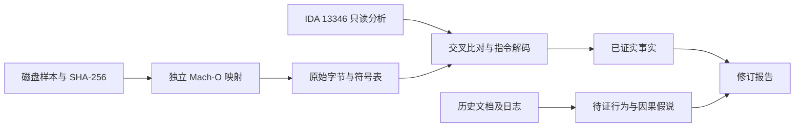

# DGAssistant（DG 管理器 v2.3.7）逆向分析总报告（字节级审核修订）

> 2026-10-16 四轮审核：前31+60个核心/按钮/进程用例见 §10–12；第四轮新增35个种子来源及非空进程表断言用例，含1个预期空地址读取，见 §13。三份报告同步修订；真实设备/API输入仍明确建模，不冒称设备实测。
> 性质:对一款 iOS 越狱外挂/多功能工具的系统性逆向,目的在于(1)研究其**清理功能**以自建清理工具、(2)研究其**加固手法**用于自己的 App、(3)复刻其**授权后端**用于自己的产品。全部分析在授权的本地设备上完成。

---

## 0. 摘要（一页速览）

| 维度 | 结论 |
|---|---|
| 标的 | `DGAssistant`,bundle `apple.allIDTDG`,iOS arm64 Mach-O,~23MB,cryptid=0,经 **TrollStore** 安装 |
| 用途 | 多游戏外挂/改机工具:和平精英(ShadowTrackerExtra)、PUBG HD(com.tencent.tmgp.pubgmhd)、球球大作战(com.juzi.balls);注入 `520.dylib` |
| 保护层 | CFF+MBA 平坦化、三套字符串加密、API 调用（CCCrypt 为静态导入）、反调试/反注入历史线索、网络重定向待证、伪装持久化、内嵌 RSA 私钥 |
| 本轮已核实 | §10静态纠错；§11核心31例；§12按钮/进程/helper 60例；§13真实种子来源及非空进程表35例，总126个断言用例，含1个预期空指针失效 |
| 历史网络记录 | 旧报告称连接 154.222.16.171；本轮未找到对应原始连接/解析日志，服务器身份、地理位置及 DNS 劫持均待证 |
| 授权模型 | 远程授权/放行仍为历史模型；本地隐藏种子已证实有多源优先级，且部分路径使用32位字序MD5，不能统称标准MD5(设备)，见 §13 |
| 衍生交付 | PHP(Laravel/standalone)+ Swift 的**DG 克隆授权后端**,历史记录称已验证，本轮未复测，见 `license-server/` |

历史方法包括Frida观察和批量字符串恢复；本次三轮审计另有静态字节核验及原指令离线回放。不能由单路径执行推出完整CFG、全部字符串或完整协议。

---

## 1. 标的概述

- 二进制:`extracted/Payload/DGAssistant.app/DGAssistant`,arm64 Mach-O,未加密(cryptid=0),约 23MB。
- 身份:DG 管理器 v2.3.7,bundle id `apple.allIDTDG`,TrollStore 分发(非 App Store)。
- 功能面:
  - **外挂/改机**:向游戏注入 `520.dylib`;目标含 和平精英/ShadowTrackerExtra、PUBG HD、球球大作战。
  - **清理**:清系统残留 / 更换标识符 / 清 keychain 残留 / 清数据库缓存(详见 §4.3)。
  - **隐藏**：已确认按钮到命令分派、Info.plist变更/备份恢复，再到helper刷新及backboardd终止请求的链路；设备侧生效与权限结果不冒称实测，见 §4.4、§12。
  - **装巨魔**:自带 opa334 真 `trollstorehelper` + `TrollStore.tar`/`ldid`,可装/卸 TrollStore。
- 架构：同一二进制按argv复用已由原指令回放确认。启动器设置persona=99、persona flags=1、UID/GID=0；这是提权请求，不等于操作系统授予了root。两种启动器的失败处理不同，见 §12。
- 段布局(VA / size / fileoff):`__obf`(大段代码，存在 CFF；并非全部代码)0x1000044E8 / 0xB660FC / 17640;`__cstring` 0x100BA180B;`__cfstring` 0x100C41438;`__data` 0x100C4B010。

> 详见 `FINDINGS.md`。

---

## 2. 保护层总览（按强度）

| # | 层 | 强度 | 攻破方式 |
|---|---|---|---|
| ① | CFF + MBA 不透明谓词平坦化 | ★★★★★ | Unicorn 预置谓词全局量后跟 `br`;静态线性解析失败 |
| ② | 字符串加密(三套:逐字节 XOR/MBA、AES-128-CBC、分块 XOR) | ★★★★ | 历史批量恢复；覆盖率和正确率未闭环 |
| ③ | CCCrypt 静态导入；其他动态解析需逐项举证 | 不评级 | 磁盘符号表 + IDA 导入及调用点 |
| ④ | 反调试/反注入/反 frida | ★★★★ | 极简轻钩子避开检测点 + roothide 黑名单 |
| ⑤ | 网络地址重定向假说 | 待证 | connect 不能单独证明 DNS/hosts 劫持 |
| ⑥ | 伪装持久化(com.apple.* plist) | ★★★ | dump plist 即现形 |
| ⑦ | 内嵌 RSA 私钥 + 防篡改退出 | ★★★/反面教材 | 直接提取私钥(灾难级弱点) |

> 逐层"它怎么做+你怎么复刻+弱点"见 `HARDENING_TECHNIQUES.md`;保护层记忆见 [[dg-manager-protection-layers]]。

---

## 3. 逐层技术拆解

### 3.1 控制流平坦化 CFF + MBA（局部证据）
- 部分已检查函数存在 dispatcher(`BR X8/X9/X10` + 派发表),用 MBA(混合布尔算术)不透明谓词算跳转索引。
- 谓词用**固定全局常量**构造恒等式,旧分析称结果为常数索引，但尚无全程序恒等式证明。本轮核对磁盘值的全局量:
  `dword_100C50260=0x0E5B8705 / 64=0xAB7E17E0 / 68=0x5F793A0A / 6C=0xCA7C333D / 278=0x17D48128 / 7C=0xB50E6B06 / 050=0x069781A0 / 54=0xB8ED0717 / 58=0xFBDB1CA7 / 5C=0x94AEE474`。
- **攻破**:`uni_decrypt2.py` 的 Unicorn харness 预置这些全局量 → 跟着 `br` 走到真正的 case 块 → 可恢复被执行路径。D-810 的历史效果本轮未复测，不能据此宣称完整还原。
- **弱点(加固启示)**:谓词用固定常量 → 模拟器可跟。应绑运行时/输入相关值。

### 3.2 字符串加密（历史分类；覆盖率未证实）
1. **逐字节 XOR/MBA 就地解密**:历史记录给出部分对象的相邻缓冲布局，不能推广为所有 CFString；本轮单条 URL 的 MBA 可化简为逐字节 XOR，其余未全量证明。
2. **AES-128-CBC(key==iv)**:`Base64 → AES128Decrypt(key,iv=key) → UTF8`,敏感串/网络数据走这层。选择子 `ACPDS:kaiv:`/`AES128DecryptWithKey:iv:`/`AES128Operation:key:iv:`;CCCrypt 为静态导入（已纠正）；具体模式、参数及 key==iv 尚未逐调用复核。
3. **分块 XOR 混淆常量(Layer 1c,本项目新发现)**:keychain 删除 SQL、SystemGroup 路径、标识符 plist 名/键 等**最敏感**的串,以密文存 `__data`,在函数序言里用 16 字节分块异或内联 key 块(key 位于 `0x100b9b6b0–0x100b9b8xx` + qword 表 `0x100b9b9d0+`)就地解密。
- **批量恢复证据不足**：`STRING_INVENTORY.txt` 头部写的是 1495 个对象、1450 条净化结果，而正文仅有 795 条地址记录（789 个不同文本字段；按物理行统计，不等同完整逻辑字符串）。旧报告的 1815 无法从该文件复核，不能给出全量恢复率。
- `dg_decrypt_all.py` 依赖 `/tmp/dg_enc_strings.json`；虽返回写覆盖标记 `cov`，调用方却未要求 `cov=True` 即接受可解码结果。异常被吞掉，且仅复原目标缓冲区，其他模拟内存/状态未完全隔离，存在误收和跨对象污染风险。本轮未重跑此脚本。
- `0x10166f4b0` 是 IDA 为 `___CFConstantStringClassReference` 建立的导入地址，不是磁盘中所有对象的固定 isa。例 `0x100C42DF8` 在磁盘首 qword 为零，IDA 显示绑定后的地址；不得混用两者扫描原始文件。
- 关键发现:每串 MBA 加密**对动态极硬**(用到才短暂解密、用完可能重加密),但**对静态 Unicorn 几乎透明**(确定性、密钥烤进指令)——这是攻破字符串保护的核心手法。
- **弱点**:MBA 可化简、key==iv、AES key 硬编码(见 §5)。

### 3.3 API 解析（纠正：CCCrypt 是静态导入）
- 原断言“CCCrypt/CommonCrypto 不出现在导入表，靠 dlsym+XOR 解析”被反证。Mach-O 未定义外部符号 `_CCCrypt` 的 nlist 位于文件偏移 `0x1677588`，IDA 导入地址 `0x10166F8F8`，桩 `0x100B6A5E4`。
- 直接调用例：VA `0x1000152D4` / 文件偏移 `0x152D4`，原始字节 `c4 54 2d 94`，ARM64 `BL 0x100B6A5E4`。本轮复核 9 个直接调用，见 §10。
- `_dlsym` 的确存在导入，但它不能证明 CCCrypt 由其解析；其他 API 的动态解析需单独追踪。

### 3.4 反调试 / 反注入 / 反 frida（历史推断，机制待逐点复核）
- `ptrace(PT_DENY_ATTACH)` + `sysctl` 查 `P_TRACED`(含裸 `svc` 系统调用变体绕 libc hook)。
- 反 frida:枚举已加载 dylib + 枚举全部 ObjC 类/方法找注入痕迹,命中 `abort_with_payload`(非 libc exit)。
- 越狱联动:借 roothide `libinjector.dylib`/`filter_dylib` 在启动 init 阶段检测 frida-agent 注入并 abort。
- **攻破**:(1) 在 roothide 管理器里给该 App **拉黑注入** → frida 能进;(2) 用**极简轻钩子集**(只钩框架/libc、避开它的检测点:`objectForKey:`/`UIPasteboard`/`exit`/`abort` 等一钩就秒退)→ 存活抓协议。本项目实测:`frida_light2.js`(安全集+reloadData 回溯)存活,重钩子/patch 后退出为历史观察，不是普遍规律或已证实的检测机制。

### 3.5 网络地址（URL 已复算；DNS 劫持待证）
- 二进制硬编码两条 baidu 串(均 XOR 加密):`https://www.baidu.com`(len21,**连通性探测**,`sub_10052D6D8`)、`https://www.baidu.com/yz`(len24,**真实验证请求**,`sub_100567AC0` ~40KB)。
- 磁盘中未找到 `154.222.16.171` 的 ASCII 明文，仅能排除此表示形式。旧报告的服务器归属、香港 VPS 及 DNS/hosts 劫持未获本轮原始日志支持；connect 的目标 IP 本身无法区分 DNS、代理、显式地址替换等原因。
- URL 解密已纯静态复现:解密器 `sub_10052D344` 读密文 `@0x10154A3A0`,逐字节 `^0x0E/^0xBA/^0x3B…` → "https://www.baidu.com"。
- **弱点**:动态 hook `connect`/`getaddrinfo` 一抓就穿。

### 3.6 隐蔽持久化
- 授权存伪装成苹果系统偏好的 NSUserDefaults suite:**`/var/mobile/Library/Preferences/com.apple.a676924c9f0.plist`**(模板 `com.apple.a%@%@.plist`,两段 `%@` 运行时拼接)。落地文件伪装 `com.apple.ayzuid%@.png` 等。

### 3.7 内嵌 RSA 私钥 + 防篡改
- **内嵌 RSA-1024 私钥**(明文 base64,`__cstring @0x100BA2911`,CFString `@0x100C42DF8`):n=0xb3a14a3ab838021b…,e=65537,n==p*q 已验。已存 `extracted_rsa_key.pem`。本轮复算 609 字节 DER，确认 n=p*q、CRT 参数及现有 PEM 一致。私钥嵌入构成密钥保密风险，但具体解密/签名能力取决于实际用途与信任链；不能推出“可伪造一切”，也不能仅凭此认定静态链接 OpenSSL。
- 防篡改:完整性/环境校验失败 → 解密串 `"Fatal error, exiting app"` 退出(~40 处 gate)。

---

## 4. 功能机制拆解

### 4.1 激活/黑屏门控子系统（历史模型；本轮仅核实 viewDidLoad 派发）
```
启动 → AppDelegate didFinishLaunching → refreshUI 无条件建 UIWindow→UINavigationController→ViewController
     → -[ViewController viewDidLoad] 本方法中未见直接建 UI，调用父类实现后 dispatch_async 一个后台块（整数运算本身不能证明反篡改/完整性哈希）
     → 后台块驱动:采集设备信息→CC_MD5→machine_code→AES 请求→POST 154.222.16.171→解密 license
     → state=正常 → 写 tz0111endtime(NSDate)+ntt=0 到伪装 plist
     → 校验通过 → sub_1002C6FAC(中央 license/调度 57KB CFF)→ sub_1003CF990 → UITableView reloadData → 主应用列表出现
     → 校验不过 → 弹错误 → exit(0)
```
- **历史黑屏解释（未完成因果验证）**:ViewController 从启动就在,但 `viewDidLoad`/`viewDidAppear:` **同步不建任何 UI**,全甩后台异步块,所以是裸黑视图。渲染要等异步门控通过后由中央 CFF 函数动态派发 `reloadData` 才出。
- 关键纠正(本项目):`-[ViewController stts]` 是 **CLLocationManager 后台保活**,不是激活检查。
- “需要再启动一次”是历史观察；持久化写入与 UI 放行之间的完整数据流未在本轮验证，不能断言只能在下次启动读取。
- 剪贴板激活:`sub_10052A2F0` 读 `generalPasteboard.string`→trim→长度/格式不透明谓词门→一分支 `exit(0)`;本地不比机器码,**服务器权威**判定。
> 详见 `ACTIVATION_ANALYSIS.md`、[[dg-activation-gate]]。

### 4.2 验证协议（历史叙述；本轮未重做动态抓取）
- **机器码**:`machine_code = MD5(设备信息) + "-520-22"`;**username==password==machine_code**(纯设备指纹当账号,无盐)。首个请求用全零机器码兜底,随后发真值。
- **请求**(握手式,多个):`{machine_code,machine_codee..eeeee(传感器/随机),username,password}` → AES → `{data25:hex}` / `{code:nonce, data:b64}` 发出;另有隐藏字段 `super_password`(携带真机器码,像后门/降级通道)。
- **响应**:`{code:257, data:hex(AES(licenseJSON))}` 成功 / `606`未激活 / `601`非法 / `203`。license JSON 字段:`state(正常) / endtime(unix) / sign / udid(=机器码) / stt / ss / ss5 / sss / ssss / token / tk / point / gg(公告) / data/data2/data3/data4(嵌套二次 AES)`。
- **多层 AES**:传输层 + license 层 + 字段层,**运行时密钥分用途**(16 位 ASCII):`DrT8h0Fj70l522Ri`(主 license)/ `ICmCIVMIKNQfFXuT`(机器码)/ `X4Q97SvE2da9FaMA`(时间戳)/ `W8emAZDGdcysx4R6`(ss),另 dump 到 `AftMekmbEc9amLl0 / 3bMnE5URyieSXpFR / rdsqacqpywBK7BO5 / yxRildhDY9NRjJB6 / P3G9s5JL61JMRAY0`。→ 这些值的来源需追踪；与旧静态候选不同，不足以证明由服务器派生或“静态拿不到”。
- **动态验证逼真实服务器拒绝**:spoof 机器码为假值 → 服务器回 `code=601/606` → 走失败路径(实测)。
> 详见 `PROTOCOL_ANALYSIS.md`、[[dg-verification-endpoint]]。

### 4.3 清理与标识符（核心路径及第三轮按钮映射）

本轮直接连接13346，以原始ARM64/CFF指令回放；Foundation文件操作使用内存模型，SQLite真实操作内存数据库。已补齐调用参数、解密路径/SQL及成功/失败分支；设备层删除和系统服务重载没有实际执行。

1. **清空目录**：`+[dfyyDG2 cleanFolderAtURL:]`@`0x1000E3E94` 的X2是URL，枚举/判目录后递归，对普通文件调用 `removeItemAtURL:error:`。回放中的 `.keep` 和子目录 `.xyz` 均删除，**没有旧报告所说的扩展名白名单**。
2. **筛选清理**：`deldir2:withSizeInMB:`@`0x1000E55E0`，X2=路径/URL、X3=整数MiB，按完整路径 `containsString:` 分支。`.sqlite/.db/db-wal/db-shm/.log` 命中删除；`.pak/.sig` 是已走通的保留分支。plist字典先清空写回，后续仍在 `0x1000E7A00` 删除，撤回“仅清空不删除”。其余合格文件在 `size < X3*1048576` 时删除。
3. **小文件缓存清理**：`delcache52:withMaxFileSizeInKB:`@`0x1000E9038` 用 **D0=double KB**，不是X3整数；字节数/1024严格小于阈值才走对应删除分支。1023/1024/1025字节与1.0KB边界已回放。另一个 `deldatlogsql52:`@`0x1000EC5AC` 的用例删除 `.dat/.log/.db`，保留 `.sql/.sqlite`，不能凭方法名推断行为。
4. **钥匙串删除**：`Resetsj:`@`0x100A2265C` 依次以模式2/0/1/3调用 `clkcin2:bundleID:`@`0x100A21264`。数据库路径原指令解出为 `/var/Keychains/keychain-2.db`。除 `DELETE FROM %s WHERE agrp like '%%%@%%'` 外，还存在 `DELETE FROM %s WHERE %s LIKE '%%%@%%'`：枚举表结构并对TEXT列生成删除SQL，实际调用 `sqlite3_exec`@`0x100A22140`。合成数据库中 agrp无关、但label含目标bundle的行也删除，范围超过access group。权限助手是独立分派，不能断言每次调用前后自动 chmod。
5. **标识符改写**：`Reuid:idv:ida:`@`0x100A239C8` 对VID/AV长度与18比较，**短值才生成UUID，长度足够则保留参数**。枚举 `/var/containers/Shared/SystemGroup`，匹配 `com.apple.lsdidentifiers.plist`；`modla:bundleID:newvid:newav:`@`0x100A22D80` 的真实层级为 `root.LSVendors[vendorKey].LSApplications` 包含bundle后改组内 `LSVendorIdentifier`，并改root的 `LSAdvertiserIdentifier`。首个成功条目后返回；不匹配不写文件。不能由持久化字段变化推断所有运行中App立即得到新IDFA/IDFV。

上层调用例 `0x10032D070` 把目标 `dataContainerURL` 与W3=2传给筛选器；`0x10032D100` 传D0=2048.0给KB缓存清理器，路径由容器路径追加已解密常量 `/Library` 构成；同块还有 `/tmp`，见参数字节锚点。旧报告把所有功能合并为一个递归器、把未命中字符串视为功能不存在，均撤回。

> 完整路径、SQL、字节、参数和模型副作用见 `CLEANUP_ANALYSIS.md`。

第三轮已映射“一键新机”“清理系统残留”“变更新的标识符”“清理KeyChain残留”“清理数据库缓存”五个按钮。一键新机先提交 `-Callreuid <bundle>`、`-CallResetsj <bundle>`，并在父进程继续调用标识符/Keychain核心及容器清理；完成回调还有目录重建与“结束持久化”子命令。缓存按钮另调用 `dfyyDG.deldir:withSizeInMB:`，参数3；其已验证的小文件路径会删除pak/sig，不能套用 `dfyyDG2.deldir2` 的保护结论。完整地址、先后顺序和SQL见子报告 §8。

### 4.4 隐藏/恢复（文件核心及第三轮进程链）

该范围有多个独立函数，不能把相邻CFF块全当作同一个函数：

- **备份**@`0x1000E30A0`：检查 `P=<bundleDir>/Info.plist` 存在且 `Q=P+.bak` 不存在；`0x1000E3390` 的参数为X2=P、X3=Q、X4=NSError指针，普通复制整份内容。已有Q不覆盖。
- **隐藏**@`0x1000E1444`：给Bundle ID **追加二字符后缀**，删除 `CFBundleURLTypes` 和 `LSApplicationQueriesSchemes`，`0x1000E1E58` 写P、W3=1。此入口回放保留DisplayName；重复调用会重复追加后缀。
- **去后缀**@`0x1000E1F58`：匹配后缀后 `length-2`，再写回；这是旧报告错放在隐藏路径的截断操作，不能补回schemes。
- **整份恢复**@`0x1000E34E0`：Q存在 → P存在则先在 `0x1000E3894` 删除P → `0x1000E3DD4`（或等价块3D34）复制Q到P → 成功后在 `0x1000E3C64` 删除Q。**删除P成功而复制失败时，P缺失、Q保留**；该流程不是原子替换。
- 后缀生成器对非nil种子作标准MD5字节hex并取 `(15,2)`。第二轮固定seed隔离测试仍保留；第四轮已执行 `0x1005146EC`真实来源选择、内层字序MD5、后缀及隐藏入口。外层nil→DG分支存在，但全源失败且IDFV=nil时提供者内部可能先空读，不能保证走到DG，见 §13。
- 实际按钮链已补齐：`rthe`菜单中的回调 → `sub_1001001DC` → 自身 `-Set2cd 隐藏程序/恢复程序 <bundle> 2` → 中央分派的文件核心；父进程随后安排约0.1秒后的 `sub_1003AD518`，提交 `<本包>/trollstorehelper refresh-all`。独立“刷新程序”按钮有自己的后台块，不经过隐藏文件核心。
- 随包helper的 `refresh-all` 在UID为0时清理限制项、请求删除IconsCache、以(1,1,1)请求重建应用数据库并重新注册，最后向名称匹配 `backboardd` 的进程发送SIGTERM(15)。不是主程序直接杀SpringBoard；请求失败/实际系统效果见 §12和子报告 §9。

> 原始寄存器、失败分支与字节锚点见 `HIDE_RESTORE_MECHANISM.md`。

---

## 5. 关键数据总表（速查）

**密钥/凭据**
- RSA-1024 私钥:`extracted_rsa_key.pem`(`__cstring @0x100BA2911`)。
- 历史静态 AES-128 候选(hex；本行仅列 6 个，“第 7 个”及用途待证):`758904d765b65e4bb41d080976b63a35` / `b7db0cf0648ac60fc86d83e813f924cf` / `3b9e61ab64dc8ad1980dd5b30c237767` / `c6f0cad80627f6480140778267d4e0af` / `503f8b0e3ba750cb90c531bf2c62c9bc` / `b327fe01111cb257ce6484e4be74db98`（第 7 个未列）。
- 9 个运行时 AES-128 key(16-ASCII):`DrT8h0Fj70l522Ri / ICmCIVMIKNQfFXuT / X4Q97SvE2da9FaMA / W8emAZDGdcysx4R6 / AftMekmbEc9amLl0 / 3bMnE5URyieSXpFR / rdsqacqpywBK7BO5 / yxRildhDY9NRjJB6 / P3G9s5JL61JMRAY0`。

**网络**
- `https://www.baidu.com` 已由磁盘密文复算；`/yz` 用途及 `154.222.16.171` 归属为历史记录，DNS 劫持待证。

**授权本地存储**
- 伪装 plist:`/var/mobile/Library/Preferences/com.apple.a676924c9f0.plist`(模板 `com.apple.a%@%@.plist`,运行时拼接)。
- 字段:`tz0111endtime`(NSDate,核心到期)、`ntt`、`tz0111cs/cc/ct/cst/cst12/udid/udidd/cc2`。

**服务器状态码**:`257`=成功 / `606`=未激活 / `601`=非法 / `203`。

**关键函数**:中央 license/调度 `sub_1002C6FAC`(57KB);验证网络 `sub_100567AC0`(~40KB);激活块 `sub_1002F1B14`;keychain 删除 `clkcin2:bundleID:`@0x100A21264;标识符改写@0x100A22D80;目录清空@0x1000E3E94;筛选清理@0x1000E55E0;备份@0x1000E30A0;隐藏追加后缀@0x1000E1444;整份恢复@0x1000E34E0。

**典型解密串(错误族)**:`复制的兑换码错误.充值卡错误` / `请复制兑换码.启动程序N` / `授权错误5237·5231\n请重启手机` / `网络错误` / `应用ID错误` / `程序错误5-2` / `BA错误1.请重试`。全量见 `STRING_INVENTORY.txt`。

---

## 6. 方法学与关键突破

**历史工具链（不等于本轮使用情况）**
- 静态:IDA Pro(MCP)、`macho.py`(VA↔file 段表)、`uni_decrypt2.py`(单串 Unicorn 解密)、`dg_decrypt_all.py`(全量 MBA 批量解密器)、capstone/unicorn。
- 动态:frida(17.x,需 `frida-compile`+`frida-objc-bridge`);脚本 `frida_light2.js`(安全集+渲染回溯)、`frida_forceerr.js`(spoof 机器码逼拒绝+拦退出)、`frida_dumpstr.js`(只读内存串 dump,flags 0x7c8 匹配)。
- 跨语言校验:PHP openssl ↔ Python pycryptodome ↔ Swift CommonCrypto(AES-128-CBC key==iv 一致)。

**关键突破**
1. **CFF→Unicorn**:预置不透明谓词全局量,让模拟器跟着 `br` 走到真 case 块——线性反汇编不能直接给出完整可达控制流。
2. **全量串解密**:定位每串内联 MBA 解密器(xref→dataptr),Unicorn 从入口跑、跟 `br`、以 dataptr 写满为停。覆盖率待核：清单头部 1495/1450 与实际 795 条地址记录不一致。
3. **frida 进得去且活得住**:roothide 里拉黑该 App(绕 `filter_dylib`)+ 只钩框架/libc 的极简集(避开检测点)。历史记录称重钩子或修改代码后退出，但缺少对照实验和检测点证据，不能归因为已证实的完整性哈希。
4. **只读内存 dump 的坑**:旧记录关于 `Module.size` 的说法需结合 Frida 版本复测；扫描应使用实际映射范围而非硬编码上界。本样本 Mach-O CPU subtype=0（arm64），不能据此认定 arm64e/PAC；仅匹配 flags 也不足以确认对象有效。
5. **逼失败路径**:JSON 序列化时重写机器码为假值 → 服务器 `601/606` → 实证"错误后退出"。

---

## 7. 加固评价与给自己 App 的建议

**基于证据的评价**：存在 CFF/MBA 和字符串变换，能增加分析成本，但不是密码学安全边界。CCCrypt 静态导入已确认；“DNS 劫持”“运行时派生密钥”“改 plist 即续期”“完整性哈希检测所有 hook”均不能作为已验证优点或弱点。

**建议**：服务端保管签名私钥，客户端验签并校验设备绑定、有效期和重放；避免 RSA-1024 和客户端长期私钥。优先采用成熟的认证加密方案，CBC 不应复用 key 作为 IV。混淆属于纵深防护，不替代服务端鉴权。内嵌私钥的实际影响须补充其调用路径及服务端信任链后评估。

---

## 8. 衍生交付物：DG 克隆授权后端（自用）

应需求做的一套 **PHP(Laravel + standalone)+ Swift 客户端** 的 DG 忠实结构授权后端,历史记录称本地端到端及跨语言验证通过（本轮未重跑）。在 `license-server/`:
- 协议忠实克隆(`POST /yz`、AES-128-CBC key==iv、`state=正常/endtime/udid/gg/token/sign`、`257/606/601` 码、机器码=md5+后缀),但**密钥全部换成自有**(DG 的已被提取=公开)。
- 顺手修了 DG 两个大坑:**私钥不进客户端**、license 带**验签+设备绑定+过期**三重校验(伪造响应被拒)。
- 交付:`standalone/`(宝塔可跑,SQLite)、Laravel 版、`client/DGActivation.swift`(门控照 DG viewDidLoad→异步校验→渲染)、`tools/roundtrip.php`(5 项测试全过)、`README.md`。
> 详见 `license-server/README.md`、[[dg-license-server-build]]。

---

## 9. 附录

### 9.1 项目文件清单
| 文件 | 内容 |
|---|---|
| `MASTER_REPORT.md` | 本总报告 |
| `FINDINGS.md` | 原始事实:段布局/CFF/字符串/RSA/协议雏形 |
| `ACTIVATION_ANALYSIS.md` | 激活/黑屏门控(静态+动态+全量串解密) |
| `PROTOCOL_ANALYSIS.md` | 验证协议完整拆解(动态) |
| `CLEANUP_ANALYSIS.md` | 4 清理功能静态钉死 |
| `HIDE_RESTORE_MECHANISM.md` | 隐藏/恢复(Info.plist.bak) |
| `HARDENING_TECHNIQUES.md` | 加固手法逐层+弱点+建议 |
| `STRING_INVENTORY.txt` | 历史字符串清单；头部计数与正文记录数不一致，见 §10 |
| `extracted_rsa_key.pem` | 提取的 RSA-1024 私钥 |
| `macho.py` / `uni_decrypt2.py` / `dg_decrypt_all.py` | 段表 / 单串 / 全量 Unicorn 解密器 |
| `frida_*.js` / `frida_gate_run.py` | 动态钩子与 runner |
| `license-server/` | DG 克隆授权后端(PHP+Swift) |

### 9.2 IDA 速查
本轮直接连接 `http://127.0.0.1:13346/mcp`，IDA 9.3，Hex-Rays 可初始化；输入 SHA-256 与磁盘一致。旧端口 13352/切换到其他实例的说明不适用于本次审计。IDA 的导入伪地址和已应用的绑定不能当作原始文件字节；大函数边界是数据库识别结果，不保证等于原始语义函数范围。

### 9.3 免责
本分析在授权的本地设备上进行,用于防御性研究(自建清理工具 + 自研 App 加固 + 自有产品授权后端)。请勿用于规避他人软件授权或其他非法用途。


---

## 10. 2026-10-16 第一轮静态审核证据与边界

> 本节保留第一轮的验证范围；清理/隐藏的新增正面证据及Unicorn回放见 §11，相关子报告已同步更新。

### 10.1 范围和样本身份

授权见 `work/dgassistant-byte-audit/scope.md`。仅本地样本、既有材料及 `127.0.0.1:13346` 的只读 IDA 查询；没有运行样本、连接设备/远端服务器、修改二进制或主动修改 IDB。原报告备份在 `work/dgassistant-byte-audit/evidence/MASTER_REPORT.before.md`。

- SHA-256：`1f39b8894177d709c1c1b7b9dc76bbd8e70cfb3a9f5940e5a536edf1a4116139`，与 IDA 记录一致。
- 磁盘大小：23,800,176 字节；Mach-O arm64 / CPU subtype=0；37 个 load command；`LC_ENCRYPTION_INFO_64.cryptid=0`。这表示无该层文件加密，不表示无混淆/字符串加密。
- Info.plist：`apple.allIDTDG`、版本 `2.3.7`、build `1`；这些元数据不证明实际安装渠道。
- IDA 9.3、Hex-Rays 初始化成功。`__text`、`__obf`、`__stubs` 三个完整区间的 IDA 字节 SHA-256 与独立磁盘切片一致，不只是抽样一致；不意味着每条指令的语义已经分析。
- IDA 显示的 68,633 个函数是当前数据库分析结果，不是源程序函数数。多个函数反编译只剩 `BR X8/X10`，不能把截断的伪代码当作完整函数。

### 10.2 发现登记（severity=n/a_re，报告准确性审计）

| ID | 状态/置信度 | 位置与证据 | 纠正 |
|---|---|---|---|
| F01 | 已证实/高 | §3.3；E-imports/E-calls | CCCrypt 静态导入且有直接 BL，撤回“全部动态解析” |
| F02 | 已证实/高 | §3.2；清单及脚本源码 | 1815 无来源；头部 1495/1450 与 795 条正文地址记录不一致，不能宣称全量恢复 |
| F03 | 已证实/高 | CFString `0x100C42DF8`；E-disk/E-ida | 磁盘 isa=0，IDA isa=导入绑定地址；不能拿 IDA 导入伪地址匹配磁盘对象 |
| F04 | 已证实/高 | `0x100BA2911`；E-disk | RSA-1024 私钥存在、DER/CRT/PEM一致；“可伪造一切”的影响结论撤回 |
| F05 | 已证实/高 | `0x10052D344`；E-detail/E-calls | 单条 URL 从密文及 MBA 表达式复算为 `https://www.baidu.com` 加 NUL；未证明请求用途/重定向机制 |
| F06 | 已证实/高 | `0x1002F1A80`；E-detail | viewDidLoad 调用父类实现并异步派发 `0x1002F1B14`；不证明该块是完整性哈希或重启门控 |
| F07 | 未证实 | §3.5/4.2；现存日志与文档检索 | DNS 劫持、服务器归属、运行时密钥来源、完整协议需原始证据 |
| F08 | 已证实/高 | §1/9.2；E-disk/E-hashes | `__text` 仍有代码，`__obf` 并非全部代码；连接端口改为 13346 |

### 10.3 可复核的字节锚点

所有 VA 为未滑移地址；此处 fileoff 是本次解析 load command 后计算的值，而非套用旧 `macho.py` 表。完整 23 个样本窗口见 E-disk；其中 CFString isa 差异单独解释，不当作篡改。

| VA | 文件偏移 | 原始字节（节选） | 含义 |
|---|---|---|---|
| `0x1000152D4` | `0x152D4` | `c4 54 2d 94` | ARM64 BL → `0x100B6A5E4`，CCCrypt 桩 |
| `0x100B6A5E4` | `0xB6A5E4` | `d0 06 00 d0 10 02 40 f9 00 02 1f d6` | ADRP/LDR/BR 导入桩，指针槽 `0x100C44000` |
| `0x100C50260` | `0xC50260` | `05 87 5b 0e` | 小端 uint32 `0x0E5B8705` |
| `0x100C50050` | `0xC50050` | `a0 81 97 06` | 小端 uint32 `0x069781A0` |
| `0x100BA2911` | `0xBA2911` | `4d 49 49 43 58 51 49 42` | 812 字节 Base64 RSA 数据起始；DER 609 字节 |
| `0x100C42DF8` | `0xC42DF8` | `00 00 00 00 00 00 00 00 c8 07 00 00 00 00 00 00` | 磁盘 isa=0，flags=0x7c8；后续 str_ptr=0x100BA2911、长度0x32c |
| `0x10154A3A0` | `0x154A3A0` | `66 ce da 4b 41 9e 8d cc fc e2 e3 6a 7e 2b bf b6 2b cb 91 79 f2 fd` | URL 密文，含解密后的 NUL |

9 个直接 BL 的 VA：`0x1000152D4`、`0x100015434`、`0x1000164C4`、`0x1000165D0`、`0x1005EAEE4`、`0x100886CFC`、`0x100886DEC`、`0x100888DC0`、`0x1009767D4`。全部从磁盘解码立即数，目标均为 `0x100B6A5E4`。未声称列尽所有间接调用。

独立解析得到 `_CCCrypt` 的 `nlist_64` 在 fileoff `0x1677588`，type=1（N_EXT|N_UNDF）、section=0、value=0。磁盘搜索还命中 `_SecItemDelete` 文本，但它不在本轮枚举的未定义符号/IDA 导入列表中；字符串命中也不能直接当作导入或调用证据。

URL 按反编译 MBA 表达式在模256下化简得到 XOR 掩码：`0e ba ae 3b 32 a4 a2 e3 8b 95 94 44 1c 4a d6 d2 5e e5 f2 16 9f fd`。与上述密文逐字节 XOR 得到 21 字节 URL 加 NUL。本轮是表达式复算，不冒称 Unicorn 指令级仿真。

### 10.4 证据索引及复现

证据均位于 `work/dgassistant-byte-audit/evidence/`，内容哈希见该目录 `manifest.sha256`。

| E-id | source_ref | 复现 |
|---|---|---|
| E-disk | `disk-audit.json` | `python3 work/dgassistant-byte-audit/disk_audit.py` |
| E-ida / E-imports | `ida-data.json`、`ida-snapshot-full.json` | `python3 work/dgassistant-byte-audit/ida_read.py work/dgassistant-byte-audit/ida_snapshot.py ida-snapshot.json` |
| E-detail | `ida-detail-data.json` | `python3 work/dgassistant-byte-audit/ida_read.py work/dgassistant-byte-audit/ida_detail.py ida-detail.json` |
| E-calls | `instruction-checks.json` | `python3 work/dgassistant-byte-audit/verify_evidence.py` |
| E-hashes | `code-hash-comparison.json` | 先用 ida_read.py 执行 ida_hashes.py，再用 verify_evidence.py 校验 |

E-imports 包含完整 710 条 IDA 导入：crypto 示例 CCCrypt、CC_MD5、SecKeyEncrypt/Decrypt；文件 IO/进程示例 posix_spawn 和 persona 设置函数；数据库示例 sqlite3_exec/open/prepare_v2。导入存在仅证明引用能力，不等于每条功能路径都可达。

P01（path_type=solve）：磁盘哈希 → load command 映射 → 导入符号 → 桩与 BL 原始字节 → F01 → 修订 §3.3。P02：密文 → 已反编译表达式 → 模256复算 → F05（不跨越到 DNS 因果断言）。



### 10.5 本轮限制与后续验证条件

- 第一轮仅做静态证据审计，未执行Unicorn路径回放；第二轮已补充原指令Unicorn执行及Capstone调用点解码，见 §11。D-810/d810-ng、DVGN仿真仍未执行，Hex-Rays遇CFF仍可能截断。
- 批量字符串结果需补齐逐对象输入、来源函数、写覆盖、失败状态、独立状态重置及可回放输出，才可报告恢复率。
- 第一轮未完成的清理SQL、标识符写入与隐藏恢复调用链，已在第二轮按 §11 补齐并同步子报告；本地到期校验及远程协议仍不在第二轮验证范围内。
- 没有凭现有静态数据确认新可利用的授权绕过；不对远端系统进行验证。未重跑 license-server 的 PHP/Swift 测试。
- 时间线：授权/初始化 → 13346 身份及导入核对 → 磁盘与 IDA 字节交叉验证 → 反编译/直接调用/URL复算 → 报告纠错和证据归档。


---

## 11. 第二轮：清理与隐藏/恢复逐路径证据闭环

### 11.1 验证结果

- 继续直连13346，只读采集IDA反汇编、选择器、导入绑定及调用者；样本哈希与第一轮一致。
- 四个无外部调用的原始指令区间复原数据库路径、四类SQL模板、TEXT类型标记、SystemGroup路径、标识符plist名及四个LS键，以及上层的“随机”标记、`/Library` 和 `/tmp`。每个区间使用全新镜像。
- Unicorn执行31个完整函数路径用例；Foundation接口和文件系统为内存模型，SQL由真实内存SQLite执行。原始字节没有修补，CFF BR派发跟随原跳转表。
- `verify_paths.py` 核对28,562条IDA指令记录；独立解码255个被调用点的BL目标，与实际拦截桩一致。上述数量分别是记录数/去重调用点数，不是全程序覆盖率。
- 31个最终用例均断言正常返回，并核验文件状态、SQL行集或参数边界；输入、调用轨迹及结果保存在 `path-fixtures.json`。

### 11.2 关键发现

| F-id | 证据 | 已证实的纠正 |
|---|---|---|
| F09 | E-path-sql/E-path-run | keychain删除还有通用TEXT列LIKE路径，不限于agrp；真实内存SQLite产生预期删行 |
| F10 | E-path-run/E-path-byte | cleanFolderAtURL是目录清空；筛选逻辑属于独立deldir2；pak/sig可走保留分支 |
| F11 | E-path-run/E-path-byte | plist清空重写后仍可被删除；两种大小阈值分别是整数MiB和浮点KB，均严格小于 |
| F12 | E-path-sql/E-path-run | 标识符树层级和UUID条件修正；传入长值保留，无目标匹配不写，首个成功条目后返回 |
| F13 | E-path-run/E-path-byte | 隐藏追加后缀，去后缀另有入口；核心不改DisplayName；备份检查分别针对原件/备份 |
| F14 | E-path-run/E-path-byte | 恢复先删除当前Info再复制备份；复制失败保留bak但当前Info缺失，非原子覆盖 |

所有发现的报告准确性严重度为 `n/a_re`，置信度为高（限定于已执行的原指令路径与明确的API模型）；设备系统层效果另行注明。

### 11.3 Evidence → Finding → Path

证据根为 `work/dgassistant-byte-audit/evidence/`，哈希见 `manifest.sha256`：

| E-id | source_ref | 复现 |
|---|---|---|
| E-path-sql | `path-decrypted.json`、`caller-path-plaintext.json` | `python3 work/dgassistant-byte-audit/path_replay.py decrypt` |
| E-path-run | `path-fixtures.json`、`path-fixture-summary.json` | `python3 work/dgassistant-byte-audit/run_path_checks.py` |
| E-path-byte | `path-byte-verification.json` | `python3 work/dgassistant-byte-audit/verify_paths.py` |
| E-path-callers | `path-callers-data.json`、`dispatch-path-data.json`、`tail-path-data.json` | 已保存13346只读MCP响应和采集脚本 |

P03（solve）：磁盘字节 → 原指令解密 → `Resetsj:`参数 → 原始SQL构造/执行调用 → 内存SQLite删行 → F09。

P04（callflow）：原始CFString/选择器 → 备份/隐藏/去后缀/恢复独立入口 → BR顺序及参数回放 → 复制失败状态 → F13/F14。

31用例覆盖备份缺失/已存在/复制失败、隐藏及重复调用/nil种子/写失败、去后缀、恢复缺文件/缺备份/删除失败/复制失败；标识符传入值/短值/无匹配/首成功；钥匙串多表及非agrp列；递归目录清空；路径筛选；MiB/KB边界及dat/log/db路径。

### 11.4 模型边界与交付

第二轮文件API模型用于确认原程序发起的操作、参数和依赖返回值的先后关系；没有把这些结果冒充设备文件系统实测。SQLite执行是真实的内存数据库操作。第二轮固定seed的模型边界已在第四轮补证，见 §13；按钮/进程/helper边见第三轮 §12。设备实际权限和系统状态仍未运行验证。

已同步 `CLEANUP_ANALYSIS.md`、`HIDE_RESTORE_MECHANISM.md` 与本报告 §4.3/4.4/5；原子报告及本轮修改前总报告保存在 `*.before-paths.md`。未访问第三方服务器、未改原始可执行文件。

## 12. 第三轮：按钮、提权请求、refresh-all与注销

### 12.1 范围、身份与证据

继续复用已授权的IDA实例 `127.0.0.1:13346`；不启动目标App、不执行真实spawn/kill、不访问第三方服务器。主程序SHA-256保持 `1f39b8894177d709c1c1b7b9dc76bbd8e70cfb3a9f5940e5a536edf1a4116139`。随包helper独立分析，SHA-256为 `1c3bc999bae2e8f735a10421ccea2689d6633a5a7cae4ffba06e66094af39cc9`，其地址不得与主程序同VA混用。

| Evidence | 可复核内容 |
|---|---|
| E-control-ui | `control-ui-data.json`、`control-final-data.json`、`control-cleanup-labels.json`：原始指令、五个清理按钮明文、UIKit的handler存储/传参 |
| E-cleanup-extra | `control-cleanup-extra-data.json`：13346新采集的独立deldir、系统策略、结束持久化与进程助手；非空fixture补证删除/保护分支 |
| E-control-run | `control-fixtures.json`：46个主程序用例，含9个隐藏/恢复/刷新动作、5个清理回调、命令分派、独立deldir边界与失败注入 |
| E-helper-run | `helper-fixtures.json`：14个helper用例，覆盖UID非0、重建/注册/信号失败、ClientTruth条件修改、进程不匹配及注册/注销API分支 |
| E-control-bytes | `control-byte-verification.json`：184,307条IDA记录（177,746个不同指令地址）、2,518条helper指令、732个不同直接调用/尾跳点逐字节及目标核对 |
| E-control-live | `control-final-ida-hashes.json`：本轮末再次读取IDA的三个完整代码区间哈希，与未修改磁盘字节一致 |

证据均在 `work/dgassistant-byte-audit/evidence/`。60个新增用例与31个原核心用例分别通过，共91个，不把数量当作整个App的覆盖率。校验回调 `sub_10046943C/sub_1006BFE40`、Foundation/UIKit和OS输入使用显式模型；清理菜单构造/回调边由静态字节与分段回放衔接，**不是完整授权流程通过的证明**。

### 12.2 调用链与关键纠正

以下F31–F39属于报告准确性发现，severity=`n/a_re`，置信度高，限定在所列字节、分段原指令路径及显式API模型内；不延伸为设备权限或系统效果证明。

| Path | 已闭合的调用链 | Finding |
|---|---|---|
| P-clean | 表格选择 `0x100327B28` → `shwmwa:selectedCell:uuid:yxmsresultStr:` → 菜单构造块 `0x1003368D8` → 一键新机handler `0x1003408A4` → 后台块 `0x100341270` → `yjxj2:` `0x100329D80` → 自身命令、标识符、SQL与文件清理 | F31：五个按钮不能合并成同一个清理入口；缓存按钮另用deldir，参数3 |
| P-hide | `rthe` `0x1003BA1FC` → 隐藏全部handler `0x1003C2E18` → `sub_1001001DC` → spawn `0x10010124C` → main `0x1002C2D6C` → 备份/隐藏核心；恢复全部handler为 `0x1003C42B8` | F32：“全部”是8个固定bundle，并非遍历隐藏全部已安装App；恢复提交带后缀的bundle |
| P-refresh | 隐藏/恢复回调 → `dispatch_after`(100,000,000ns) → `sub_1003AD518` → `sub_1000A8D50` → helper `refresh-all` → `_killall(@"backboardd",1)` → 匹配PID的SIGTERM(15) | F33：已定位注销触发请求，不再只保留“helper线索”；它不以注册API成功为前提 |

子进程的请求参数由原始调用寄存器确认：`posix_spawnattr_set_persona_np(attr,99,1)`、`set_persona_uid_np(attr,0)`、`set_persona_gid_np(attr,0)`；自身启动器还设pgroup=0、spawn flags=2。参数99是persona值，末尾字符串 `"2"` 是命令参数，均不能解释为有效UID。`-Set2cd`隐藏用例中换成 `"0"`、`"1"`、`"text"` 仍进入相同文件核心，不能把末项武断当作“注销开关”。

### 12.3 失败处理不是统一的

| Finding | 原指令分支/用例结果 | 影响 |
|---|---|---|
| F34 自身启动失败未阻断 | `sub_1001001DC`的spawn返回13后仍在 `0x100100F88` 调 `waitpid(0,&status,0)`；随后仍提交refresh-all | 不存在目标子进程时仍等待；PID 0具有等待同进程组子进程的语义，不能当作等待该次spawn成功 |
| F35 persona设置失败被忽略 | init返回12，或persona/UID/GID设置返回22，仍走到spawn | 只能证明请求root，不能认定请求成功；没有在这些失败点提前退出 |
| F36 通用等待状态误判 | `sub_1000A8D50`：spawn失败返回错误码13且不wait；waitpid=-1返回W0=`0xFFFFFF22`（-222），包括EINTR也不重试；raw wait status=`0x0700`返回7，而status=9返回0 | 未先确认正常退出即提取退出码，信号终止可能被报告成0 |
| F37 刷新/文件失败不等于UI失败 | 自身非零退出、wait失败、helper启动失败/退出7后，隐藏UI仍到“Loading stopped”；main在备份copy失败、隐藏write失败、恢复copy失败等用例仍返回0 | 不能由loading结束或进程退出0推定Info.plist操作与注册/注销完成 |
| F38 ClientTruth修改会请求终止profiled | helper读取ClientTruth嵌套values，反向移除无 `/System/Library/AppSignatures/<bundle>` 的值；有修改才在 `0x1002003C8`写plist，再在 `0x1002003D8`调用killall(profiled,0)，选择SIGKILL(9) | write返回NO仍请求终止profiled；无修改则不写、不发该信号，随后仍可终止backboardd |
| F39 两类清理器的保护不同 | 缓存按钮deldir(3MiB)用例删除4字节pak/sig；系统策略用例删除 `/var/stash`，却因 `<9`字符保护跳过 `/var/jb` | 不能以deldir2或blacklist文本推导所有入口的删除结果；3MiB边界与失败保留已回放 |

helper自身亦有失真：UID非0先返回-1，不执行刷新和kill；UID为0时，即使重建API返回NO、注册路径返回0、kill返回-1，`refresh-all`仍可返回0。进程列表为空或无 `backboardd` 名称匹配时不发信号。因此“请求了注销”与“设备已注销”必须分开记录。

P-restrictions（callflow）：ClientTruth.plist → `com.apple.lsd.appremoval/clientRestrictions/union/removedSystemAppBundleIDs/values` → 原始callback逐项检查AppSignatures → 仅有移除时写回并请求profiled信号9 → 后续backboardd信号15。缺文件、无需修改、write失败三个分支分别保留证据；详细地址和参数见隐藏报告 §9.5。

清理按钮的“结束持久化”子命令从main逐次提交31个C字符串给 `dfyyDG2.lrproki:`，包括重复logd_helper；它不等同于helper的refresh-all。第三轮空进程表边界已在第四轮补入非空表、子串匹配、SIGKILL及错误分支，见 §13和清理报告 §9；仍不虚报设备上已终止31个进程。系统策略的3/7/12秒排队块、25个枚举根见清理报告 §8。

### 12.4 安全复现与交付

```sh
/opt/homebrew/bin/python3 work/dgassistant-byte-audit/recover_control_labels.py
/opt/homebrew/bin/python3 work/dgassistant-byte-audit/run_control_checks.py
/opt/homebrew/bin/python3 work/dgassistant-byte-audit/verify_control.py
/opt/homebrew/bin/python3 work/dgassistant-byte-audit/run_path_checks.py
/opt/homebrew/bin/python3 work/dgassistant-byte-audit/verify_paths.py
```

这些脚本只回放样本字节和内存模型，写本案证据；不把上述argv交给主机执行。三份修订前报告保存在 `*.before-control.md`，本轮差异为 `report/*.control.diff`。更细的按钮表、路径、SQL与寄存器见两个子报告的第三轮章节；系统实际授权、缓存重建效果及UI授权门控实现不在本次离线验证中冒充已证实。

## 13. 第四轮：真实后缀种子与“结束持久化”

### 13.1 已补齐的模型边界

复用13346只读IDA、同一未修改主程序。新增35个断言用例（18个种子/后缀/真实隐藏入口、17个进程/完整子命令），原91个回归用例通过，合计126个。35个中含1个预期空地址读取，不把它混称正常返回。系统调用、文件、时钟、IDFV及内核表仍是显式输入，但**种子提供函数本体、多源选择、内层哈希、进程筛选和信号决策均执行原指令，不再用固定seed/空表替代关键逻辑**。

| Finding | 字节及路径证据 | 纠正 |
|---|---|---|
| F40 多源种子 | `0x1005146EC` → 内存全局 `0x101669448` → 系统卷来源 `0x1004B9340` → 当日缓存 `0x100504BC4` → AppleSupport日志 `0x10049B254` → IDFV | 不是单一设备UUID；已验证缓存长度4/5边界及来源优先级 |
| F41 两种MD5字序 | 内层 `0x1004B26A8`以 `%08x%08x%08x%08x`拼四个小端32位字；外层后缀是标准逐字节hex取 `[15:17]` | 不能将内层字符串直接写成常规MD5 hexdigest；真实IDFV路径后缀fixture为01而非原固定seed的4d |
| F42 nil不保证DG | 全部上游源不可用、IDFV=nil的原指令在 `0x10042C38C`读地址0、1字节 | DG只是外层收到nil时的分支，不保证提供者自身失败能安全返回nil |
| F43 进程按短名称子串匹配 | sysctl MIB `[1,14,0,0]`，记录步长0x288；`p_pid`偏移0x28，短名称偏移0xF3，`0x1000F47E4 containsString:` | 区分大小写；不是路径匹配或名称精确相等。proc_pidpath成功只是前置条件 |
| F44 错误恢复不一致 | 查询返回值未先阻断；取表错误errno=12走扩容重试，其他错误/分配失败结束；path返回≤0跳过该项 | 已用非空表验证；不能从空表用例猜测错误处理 |
| F45 终止失败不反馈成功状态 | `0x1000F48E4 MOV W1,#9`、`0x1000F48E8 kill`；kill=-1仍继续匹配其他条目，完整main最后返回0 | `lrproki:`本身是void语义，不把模型_free留下的X0=0解释为BOOL成功 |

以上严重度=`n/a_re`，置信度高，限定在原指令与列明输入内；不声称设备实际授权或终止成功。

### 13.2 种子来源与实际副作用

有效全局缓存长度≥5时直接复用；原提供者把新结果写回该全局。后续来源依次为：根卷statfs/getmntinfo所取快照标识并结合OS版本字符串；Caches下 `com.apple.ayzuid<当日摘要前5字>.png` 的UTF-8文本；AppleSupport `.log` 中正则 `serial":"(.*?)"` 的捕获内容结合OS版本；最后 `UIDevice.currentDevice.identifierForVendor.UUIDString`。不足5字符的缓存继续回退；来源组合和实际哈希输入见隐藏报告 §10。

Documents下 `.apple` 在启动辅助代码中被创建为目录，不是已证明的种子文件。缓存PNG扩展名不代表图像解码；该链使用UTF-8读字符串，不把文件存在当种子有效。当前模型时钟/UTC/OS版本均是测试输入，不是设备取证值。

### 13.3 “结束持久化”的完整非空表验证

main → 31次 `dfyyDG2.lrproki:` → sysctl查询/扩容/取表 → proc_pidpath(pid,buffer,1024)>0 → **记录短名称包含目标C字符串** → `kill(pid,9)`。完整子命令fixture使用四个进程：lsd-helper、securityd、childsecurityd命中，路径含securityd但短名称other的条目不命中。kill全部失败时仍遍历后续项且main返回0。没有把这条SIGKILL链与helper的profiled(9)/backboardd(15)链合并。

### 13.4 证据及复现

证据目录仍为 `work/dgassistant-byte-audit/evidence/`：`seed-fixtures.json`、`process-fixtures.json`、`seed-process-summary.json`、`seed-process-byte-verification.json`、`seed-process-data.json`、`seed-more-data.json`、`seed-executed-data.json`、`seed-final-ida-hashes.json`。新核对88,145条IDA记录、69,183个不同地址；248种转移组合中131个直接目标从原始立即数独立核验，其余117个为间接调用，核对指令及回放加载器绑定，不假称直接目标解码。三个完整代码区间哈希仍与磁盘一致。原始响应、API缓冲hex、预期空读均归档，覆盖数不与前轮简单相加。

```sh
/opt/homebrew/bin/python3 work/dgassistant-byte-audit/run_seed_process_checks.py
/opt/homebrew/bin/python3 work/dgassistant-byte-audit/verify_seed_process.py
```

P-seed：原始字节 → 多源优先级 → 原指令哈希/缓存回写 → 原后缀/隐藏入口 → F40–F42。P-process：真实命令分派 → 非空原始进程表 → 原匹配/信号/错误分支 → F43–F45。修订前报告保存为 `*.before-seed-process.md`；本轮差异为 `report/*.seed-process.diff`。未访问远端授权服务、未修改二进制、未执行真实设备清理或进程终止。


## 14. DG 2.3.9 授权协议离线纠正（2026-10-19；不替换2.3.7结论）

本节只适用于SHA256为3841f080d158a9a9f942eb0ca7f38ec8ba7e1677c23c1b92054fb82452e5cf78的2.3.9样本；不将本节地址套用到前文2.3.7。当前会话直接复核，未派发其他会话，未连接手机/服务器、运行DG、兑换或修改授权。敏感正文只留本地原件。

完整证据与接入缺口见[本轮协议报告](work/dg239-protocol-takeover-20261018/report/PROTOCOL_REVIEW.md)。库存193份原件，较窄事件账本155来源，二者不能混作覆盖率。2026-10-19两轮各50项离线测试通过，仅验收下述局部结论。

### 三接口的证据边界

| 接口 | 已核原件及位置 | 本轮确认 | 未闭合 |
|---|---|---|---|
| logind1 | response/evidence/first-negative-protocol-257-native.json.gz 与 first-negative-numeric-257.json.gz，均 /events/364，解析点 0x1005D08A8 | 两份离线最终 HTTP 200 输入分别为28/26字节；code分别为字符串/数字；不能统一类型 | 实机同事务最终响应、通用封装、完整解码与接受条件 |
| logind0 | startup/evidence/activation-second-json-exploration.json.gz，/events/19374/args/1 → 19377/args/0 → 19380/args/0 → 19384/args/0；响应fixture另见 second-negative-protocol-257-native.json.gz /events/19728 | 构造片段2068→2422→2439→2456字节，最终字段id/data/data2/data3/data5/data6；解析点0x1008496AC | 构造记录socket缓冲缺正文，不等于真实发送0字节；前置crypto属请求侧，不是响应解码 |
| recharged | startup/evidence/activation-clipboard-final-exploration.json.gz，/events/672、734、1947；响应fixture另见 activation-negative-activation-*.json.gz /events/1944或1945 | 记录缓冲527字节=153字节头+374字节正文；两内层JSON版本不得互换；解析点0x10037C868 | 通用变换、真实send结果及服务器接受、最终响应到落盘关联 |

表内response/与startup/分别指工作区work/dgassistant-239-response/与work/dgassistant-239-startup/。八份响应均为离线解释器fixture，不是新增捕获的服务器响应。每份原件SHA、精确JSON pointer、字段类型及摘要见本轮interface-matrix.json。请求构造、待发送缓冲、系统send结果和服务器接受分层验收；HTTP100不是最终响应，MODEL事件不是真实库返回。

两份既有实机日志（work/dg-correlated-start-once-20261017/raw-events.jsonl、work/dg-gap-once-20261017/raw-events.jsonl）共30条JSON-resp局部观察，其description不是原始HTTP/JSON，不能恢复原JSON标量类型；邻近CONNECT、线程或时间不足以指定接口。本轮为这批记录建立的端点归属live最终响应为0，完整live解码闭合为0；不否认历史合法充值和主界面观察。

### data3与百度前置请求

- data3的0x1003C6838→frame130→0x1003C38D8比较EB008派生密钥对象长度，不是正文长度。≤1到3C5DE4，>1到3C0F60；短臂局部index0进入3C1CCC dispatcher而非RET。3C1D58外部写集未闭合，空正文/空key/nil/空字典须分开验证。
- 两个40字符参数初始化均有41字节（含NUL）；局部%02X初始化成立，但3B508C copy接收者、活跃选择及跨调用版本仍未绑定。198次fixture交换和多长度算术测试不是完整返回测试，不得据此实现“空输入直接返回空串”。
- 百度completion入口x0/x1/x2/x3的保存槽为frame3DF0/3DF8/3E00/3E10。5CAE98/5CAEA8的storeStrong消费entry_x2/entry_x3；5CE924→5FC168消费saved_entry_x0+20捕获对象，不是response-data参数。
- 5CAEC4与5E1928/5E197C是不同内存版本，不能强制相等；两分派表分别为101570F58（0→5F7BB8，1→5E8588）和101570FC8（0→5D5490，1→60428C）。局部组合不证明完整异步路径。
- 百度请求可省略仍未证明（omission_proven=false），也未证明一定业务必需。必须补齐错误/取消/正常返回到真实请求的参数、队列/锁/完成标记及全部副作用等价，不能凭“虚拟伪装”或解释器403/无响应模型直接删除。

### 启动与后端接入边界

历史确认的“合法充值提示→正常退出→再次启动显示管理主界面”保留；不把首次退出一律解释为失败。后续启动原件存在24B014事件，因此早期“未捕获”只属于当时轮次；事件存在仍不等于sign/设备/期限、缓存、异步block到UI全部同状态闭合。

已有局部server endtime→加密→tz0111ct setter及ct getter→ACPDS→signed32 intValue→double→时间比较。展示tz0111endtime不是许可，外层LE64本地时间+反馈变换+Base64不是验签；准确三个磁盘域、序列化、写后读回和失败回退仍开放。未完成可信验证前不能因code、显示日期或文件存在就授予权限。

新App兼容旧服务器的P0仍是：逐接口真实请求/连接代次与最终响应归属；全部动态字段的通用封装和活跃密钥版本；完整响应解码及sign/udid/endtime绑定与拒绝条件；缓存到24B014/UI的同attempt协调。客户端兼容不等于重建能签发旧激活码的服务器。本轮没有交付可上线兼容SDK，也不将报告验收当作完整授权链验收。


## 2026-10-19 接收对象到解析输入的局部续审

本附录仅适用于 DG 2.3.9 原样本。证据：`work/dg239-protocol-receive-binding-20261019/report/RESPONSE_BRIDGE_REVIEW.md`、`response-bridge.json`、`parser-slot-writers.json`；38 项离线测试通过、无跳过，原始失败日志保留。该测试范围不包含完整回调 CFG、真实库调用副作用或实机最终响应。

- 导入槽 `0x100B942C8` 的身份为 `_objc_retain`，不能标为 `_objc_retainAutorelease`；`0x1003A9A04` 用调用后保存槽写入目标，而非直接用 x0 返回寄存器。导入身份不等于活跃实现或对象寿命证明。
- 接收 handle 的 callback/context 存在保存、替换和恢复；调用点 `0x1008C19BC` 与 `0x1008C19E4` 分别使用 handle+0x240 / +0x250，不能混并为登记时的同一上下文。
- `logind0` 的 `0x1008496AC` 解析输入来自当次 frame+0x1160 指向槽；`0x100843FB8` / `0x100849B50` 分别准备对该目标传入零 / frame+0x370 的 `_objc_storeStrong` 调用。仅核对原字节及调用参数，未证明执行效果、同一请求的先后和完整写者集合。槽地址相同不能推出接收对象与解析对象相同。
- `logind1` 的 `0x1005D08A8` 数据来源为当次 frame+0x3768 指向槽。`0x10037C868` 是共享解析跳板，不能当作 recharged 专属实机响应的归属证据。

本轮新增端点归属实机最终响应=0、完整响应解码闭合=0。下一优先项是将 logind0 的登记/包装/累积对象/解析输入及解码结果联到同一事务，再逐接口复核。data3 空输入的完整返回、40 字符参数的活跃来源、百度正常/错误/取消到授权请求的依赖仍开放；既不能宣称百度可省略，也不能据此宣称必需。新 App 的完整旧协议兼容和缓存到主界面链仍未验收，不以局部通过授权发布可上线 SDK。
