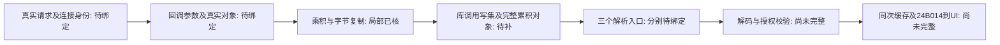

# DG239 响应接收字节续审（2026-10-19）

## 结论与范围

本轮完成的是接收回调的九段原始指令切片验证，不是完整回调、三接口解码器或兼容 SDK。仅离线读取既有样本，没有连接手机或服务器、执行 DG、兑换或修改授权。没有增加端点归属明确的实机最终响应；没有关闭完整响应解码或授权到主界面的证明义务。旧轮次的合法激活和主界面观察仍保留。

输入样本：`work/dgassistant-237-239-diff/2.3.9/DGAssistant`，SHA256 `3841f080d158a9a9f942eb0ca7f38ec8ba7e1677c23c1b92054fb82452e5cf78`。本报告所有地址是该样本的未滑移 VA。读取通过 Mach-O 段映射，不将 VA-base 直接当作文件偏移。

原字节、反汇编、导入表及选择子见 `receive-bytes.json`。19 项新增测试通过，详见 `tests-final.txt`。`tests.txt` 保留首轮因测试误写 BLR 地址而失败的记录；按原字节纠正预期为 `0x1003A9E7C` 后复验，没有修改目标字节。历史基线的 38 份 manifest 项仍匹配，没有重跑或改写历史生成器。

## 可证的局部关系

| 切片 | 原字节支持的结果 | 必须保留的前提与边界 |
|---|---|---|
| `0x1003A9CC0` 至 `0x1003A9D08` | 读取的两个数通过混淆算术生成乘积 mod 2^64，并写入 frame70 指向槽；frame24 的 32 位值为乘积是否等于零 | 输入槽别名可能改变被读取值；不是任一入口参数等于零的等价判定 |
| `0x1003A9054` 至 `0x1003A9074` | 从 frame88 候选值写目标指针槽，再读源槽、写源别名槽、清零索引槽 | 顺序不可交换；目标指针槽可覆盖后续源槽读值 |
| `0x1003A909C` 至 `0x1003A90B4` | 索引加一 mod 2^64 | 只证明此切片；不能替代完整循环和边界条件 |
| `0x1003A9550` 至 `0x1003A9590`，`0x1003A9F6C` 至 `0x1003A9F98` | `byte[dest + oldlen + index_read_2] = byte[source + index_read_1]`，地址 mod 2^64 | 两次读取独立；第二切片还要求 x10/x11/x12/x13 已分别绑定源别名/目标/旧长度/索引槽；不推定可访问范围 |
| `0x1003A9E48` 至 `0x1003A9E7C` | 在调用前，x0 是接收者槽读值，x1 选择子 `setLength:`，x2 是写后读回旧长度与当次产品槽读值之和 | 最后 BLR 是外部效果屏障；不能假设扩容成功、地址稳定或没有额外写入 |
| `0x1003AA080` 至 `0x1003AA098` | 先将当次产品写入返回槽，再以 x0=接收者槽地址、x1=0 调 `_objc_storeStrong` 导入桩 | 未执行外部调用，不证明返回槽清理后仍不变，也不证明对象寿命 |
| `0x1003A9200` 至 `0x1003A9220` | `0x1003A9204` 是 `__Unwind_Resume` 调用；后面的 length 参数准备不能由这里顺序续执行推出 | 独立从 `0x1003A9208` 开始的切片到 `0x1003A9218` BLR 截止；未证明实际控制流进入 |
| `0x1003A94FC` 至 `0x1003A9514` | `mutableBytes` 候选参数由 frame48/frame40 加载到 x1/x0；`0x1003A950C` BLR | 不替外部消息提供成功返回值；后续 frame88 对象/内存绑定仍开放 |

乘积恒等式的代数复核：令 `p=a & ~b`、`q=~a & b`、`r=a & b`。三者位互斥，所以 `a=p+r`、`b=q+r`、`a|b=p+q+r`。原式为 `p*q+r*(p+q+r)=(p+r)*(q+r)=a*b`，对模 2^64 环同样成立。它作用于实际读值，不排除此前别名覆盖；如两个操作数保存槽相同，后写值会覆盖先写值。

## 验证方式与负测试

`receive_slices.py` 仅支持所列线性 ARM64 子集。内存以字节保存、按小端读取，W 寄存器写入清零高 32 位；每次读写都有独立事件序号。BL/BLR 在效果发生前抛出屏障，不模拟库返回、retain、释放、异常恢复或后续指令。输入内存缺失、未知指令、截断字节、移位/扩展/索引寻址等未支持模式均拒绝，不能静默略过。

19 项测试包含：原字节和导入/选择子钉住；305 组乘积边界/固定种子组合；非零乘数溢出为零；操作数槽别名；两处字节复制与地址环绕；两次索引读之间人为改变内存的反例；字节写覆盖索引槽；初始化写后再读别名；索引溢出；扩容前参数及长度槽/产品槽别名；清理和异常外部屏障；length/mutableBytes 屏障；寄存器和部分字节写宽度；缺失内存及非法输入；钉住字节/导入名/选择子变异拒绝；生成证据与重建一致。

这些是显式合成前置状态，不是实机参数或库成功替身。人为改变索引的测试用于反驳错误的模型假设，不能反称原程序确有并发写入。导入表身份能定位 `_objc_msgSend`、`_objc_retain`、`_objc_retainAutorelease`、`_objc_storeStrong`、`__Unwind_Resume`，不等于运行时 IMP 或副作用已知。

复验（无网络，不写冻结证据）：

```sh
PYTHONDONTWRITEBYTECODE=1 /opt/homebrew/bin/python3 work/dg239-protocol-receive-binding-20261019/evidence/test_receive_slices.py
```

生成器只允许首次独占创建 `report/receive-bytes.json`，不是复验入口。依赖 helper、历史 manifest、原样本及发布文档 before/after 哈希另见本 case 的封件。

## 接回三个接口：仍需补的具体边

1. 回调入口的 data/size/count/context 与某一次真实传输、请求及接口身份绑定；不能从导入槽身份推出此边。原回调登记与包装/还原、完整 CFG 和全部错误分支仍未闭合。
2. `length` / `setLength:` / `mutableBytes` 的真实接收者、返回缓冲区、调用写集和异常分支；再把已证字节复制接到持有的响应对象。未补齐前不将切片命名为完整 append 实现。
3. 响应累积对象到各接口解析入口的内容/对象版本：logind1 `0x1005D08A8`、logind0 `0x1008496AC`、recharged `0x10037C868`。同线程邻近、description、fixture、请求侧加密均不能代替此边。
4. 三接口分开证明完整封装、响应解码及接受/拒绝条件；目前新增实机最终响应归属数=0、完整 live 解码新增闭合数=0。`logind0` 正文构造不等于发出，`recharged` 待发送缓冲不等于服务器接收。
5. data3 的活跃 40 字符参数来源及空输入到真实返回、百度 completion 的捕获/错误/取消/副作用依赖仍沿用旧缺口。不能实现“空输入直接空串”，也不能判定百度请求可省略或必需。

下一优先级是第 2、3 项的接收对象到解析输入桥，不继续扩大对象寿命的无边界穷举。只有逐接口到达解析输入的同状态边补齐，才能继续评价新 App 的完整旧协议兼容；此局部验收不增加整体完成百分比。


