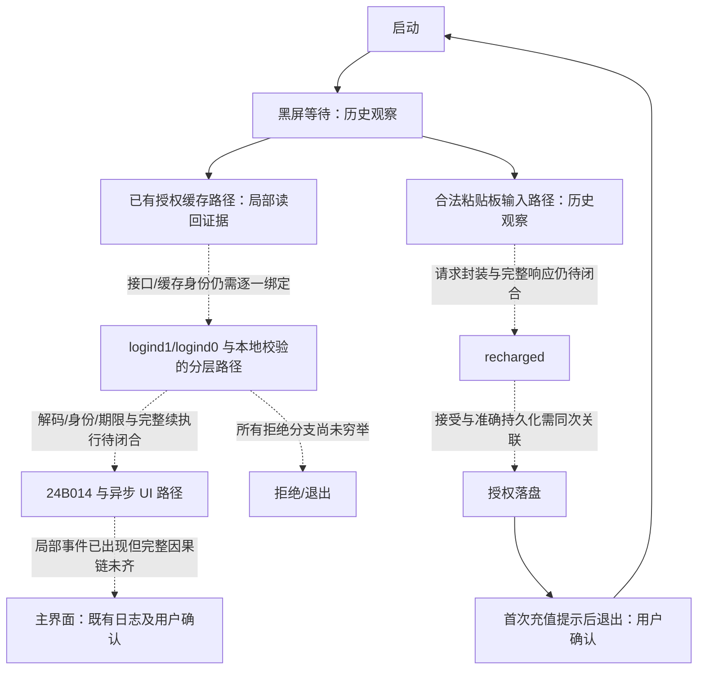

# DG 2.3.9 旧授权协议：离线接手复核与新 App 接入边界

> 2026-10-18 接手，2026-10-19 复核；普通协议逆向（flavor=null）。本轮结论：局部证据复核通过，完整旧服务器兼容尚未验收。没有请求服务器、运行 DG、连接手机、兑换或修改授权。敏感正文不在本报告重印。

## 1. 先看可以交付什么

目标不变：新 App 沿用旧服务器和旧激活码，不另造协议。目前可交付的是逐接口证据索引、部分请求构造、data3 局部字节约束、百度 completion 局部依赖，以及带缺口的启动状态机，**不是可投产授权 SDK 或已复刻的后端服务**。

- logind0 的完整 **2456 字节构造正文**已有逐段索引和摘要；构造不等于 socket 成功发送，更不等于服务器接受。
- 三个接口均定位了离线 fixture 的最终 HTTP 响应与 JSON 解析输入；这些是解释器测试输入，不能改称实机服务器响应。
- 两份启动日志中的 30 条 `JSON-resp` 是解析结果描述，不是原始 HTTP/JSON 输入；不能凭线程、时间先后或上一条 CONNECT 给它们指定接口。
- data3 短分支比较的是密钥对象长度，不是输入字符串长度；空输入最终返回值尚未证明。
- 百度 completion 确有捕获值消费和两次独立内存采样。现有证据不支持删除百度请求；“不能证明可省略”也不等于证明业务必须访问百度。
- 50 项离线测试通过，包含来源、类型、长度、分派表与原指令变异等负测试，以及保存产物从原件重建的一致性检查；不代表全部授权谓词通过或三个接口端到端兼容。

## 2. 范围与证据分级

范围见 [scope.md](../scope.md)，过程见 [timeline.md](../timeline.md)。只分析本地样本和既有记录；旧 case 保留，不重跑会改写其证据的生成器。

样本：`work/dgassistant-237-239-diff/2.3.9/DGAssistant`；SHA256：
`3841f080d158a9a9f942eb0ca7f38ec8ba7e1677c23c1b92054fb82452e5cf78`。

下文地址均为该 Mach-O 的未滑移 VA。读取按段映射到文件偏移，不以 VA 减基址代替。导入表核实 `0x100AE01F8 → _objc_storeStrong`、`0x100AE00E4 → _objc_autoreleaseReturnValue`；导入名称不证明运行时实现、对象寿命或无别名写入。

| 标记 | 能证明 | 不能证明 |
|---|---|---|
| 原字节局部 | 指令、常量、表项及明确前置状态下的局部运算 | 整条路径实际经过、外部调用无副作用 |
| 离线 fixture | 该解释器输入/输出记录及本地字节桥 | 原服务器真实返回、原库全部语义 |
| 既有实机日志 | 已记录探针位置和调用关联 | 未记录输入字节、指针的分配代次、未观测条件 |
| 历史用户确认 | 指定轮次确实显示主界面或提示 | 每个协议谓词和请求响应身份 |

库存覆盖扫描时 `work/` 下 193 份 `.jsonl`、`.gz`：70 份 JSONL、122 份 gzip JSON、1 份非单 JSON 的 gzip，合计 172,863,413 字节；比先前账本多纳入 40 份，原件变化 0。事件账本使用更窄的文件名及目录筛选，包含 155 个来源、873 条账本记录，26 个调用关联错误、4 个解析错误单独保留。这两个覆盖范围不能混用，也不是全目录所有格式的完备证明；错误来源不能用于无条件串链。见 [corpus-inventory.json](corpus-inventory.json)、[ledger-summary.json](ledger-summary.json)。

## 3. 三个接口分别列证

### 3.1 请求与响应总表

下表路径来自 fixture HTTP 起始行；`POST /index.php/api/User/<接口>` 不代表本轮向线上发送过请求。服务器主机、激活码、设备值和密钥不重印。字段顺序、转义、动态类型和密钥版本未证部分不得用通用表单编码器猜补。

| 接口 | 已定位请求证据 | 响应解析边界（原 VA） | 目前可用于兼容的边界 |
|---|---|---|---|
| logind1 | 历史原 URL 与 fixture 目标摘要匹配；本轮分开核请求头、分离 body 和返回 fixture | `0x1005D08A8` | 字符串/数字 code 两个 fixture 分开保存；缺真实同事务最终响应到完整解码/接受链 |
| logind0 | 2456 字节构造体；字段 `id,data,data2,data3,data5,data6`；构造片段逐段摘要一致 | `0x1008496AC` | 请求内层 JSON 及部分编码链可追；未在该构造记录的 socket 缓冲中找到正文，不能宣称实际发送 0 字节或正文已经发送 |
| recharged | 同 fixture 有 374 字节正文及 153 字节请求头，共 527 字节记录缓冲；内层 `username,recharge_card` 及后续 `data3` 对象已定位 | `0x10037C868` | 仅该样本构造/缓冲记录成立；缺通用变换、真实发送结果、最终响应解码与落盘关联 |

**不把所有 code=257 合并成一种类型。** fixture 字符串 `"257"` 的响应体为 28 字节，数字 `257` 的对应体为 26 字节；这是 fixture 输入差异，不据此推断服务器对两者等价，也不将 code 单独当成授权成立。

### 3.2 八份响应 fixture 的原始定位

相对工作区前缀为 `work/dgassistant-239-response/evidence/`。每份的压缩原件 SHA256、HTTP 状态/长度、socket effect 索引、解析输入摘要、字段类型均列在 [interface-matrix.json](interface-matrix.json)。`/events/N` 为 JSON 数组索引（从 0 开始），不是行号。

| 原件 basename | 接口 | 解析事件 | 响应体字节 | 性质 |
|---|---|---|---|---|
| first-negative-protocol-257-native.json.gz | logind1 | `/events/364` | 28 | 离线 HTTP 200，code=str |
| first-negative-numeric-257.json.gz | logind1 | `/events/364` | 26 | 离线 HTTP 200，code=int |
| second-negative-protocol-257-native.json.gz | logind0 | `/events/19728` | 28 | 离线 HTTP 200，code=str |
| activation-negative-activation-257.json.gz | recharged | `/events/1944` | 28 | 离线 HTTP 200，code=str |
| activation-negative-activation-status-303.json.gz | recharged | `/events/1945` | 28 | 离线 HTTP 200，code=str |
| activation-negative-activation-status-304.json.gz | recharged | `/events/1945` | 28 | 离线 HTTP 200，code=str |
| activation-negative-activation-status-305.json.gz | recharged | `/events/1945` | 28 | 离线 HTTP 200，code=str |
| activation-negative-activation-status-306.json.gz | recharged | `/events/1945` | 28 | 离线 HTTP 200，code=str |

本轮逐份验证：固定来源 SHA、请求端点、记录内 fd、请求后无重连/关闭后复用、HTTP Content-Length、最终响应体与解析实参逐字节相等、解析 options=1、结果的严格 JSON 类型。限制仍是 `live_transaction=false`、`send_result_verified=false`、`connection_epoch_verified=false`、`full_response_decode_proven=false`。记录内部身份检查不是系统 socket 连接代次证明。

logind0 的四次 crypto 调用在上述响应解析**之前**，属于请求侧，不能拿来充当响应解码证据。解析后的 `MODEL:` 事件也不能提升为真实库返回。HTTP 100 Continue 不是最终响应。

### 3.3 logind0 正文已恢复到哪一层

来源 `work/dgassistant-239-startup/evidence/activation-second-json-exploration.json.gz`，SHA256：
`5908d5aff538cc864be31906f3d6837581db1294c2d719e017790d5ffb61a5b5`。

| 位置 | 可核实内容 |
|---|---|
| `/events/400`，`0x100896794` | 277 字节 JSON；username/password 及五个 machine_code 系列字段均为字符串 |
| `/events/490`，`0x10084FCA8` | 59 字节 JSON；data=str、code=int |
| `/events/673`，`0x1008133A8` | 283 字节 JSON；前述结构末两个 machine_code 系列字段改为 int，不能统一字符串化 |
| `/events/19349`，`0x10089669C` | 2061 字节 JSON；data25=str |
| `/events/19374/args/1` → `/events/19377/args/0` → `/events/19380/args/0` → `/events/19384/args/0` | 2068 → 2422 → 2439 → 2456 字节正文对象片段 |

最终构造体 SHA256：`fcf2cbae9e512dde841b7df9fdfdb0641a6938e4fdb5cb4464716425bb64740c`。该记录的待发送请求头为 174 字节、声明 body=2456，但记录的该 socket 缓冲没有 body。结论只能是“构造体存在、该发送缓冲记录缺正文”。

历史局部链为 JSON → 16 字节周期异或 → Base64 → AES → Base64 → RSA 分块 → Base64 → hex/交换 → data25；它仍受 fixture 输入、密钥/掩码活跃版本和外部调用模型限制。不得把该链反向当作完整响应解码器。

### 3.4 recharged 正文与 live JSON 日志

构造来源 `work/dgassistant-239-startup/evidence/activation-clipboard-final-exploration.json.gz`，SHA256：
`946560b2c77ae7dd7793384e6af1a4459dd6c50de298758d0690e2f2a2c33cbd`。
`/events/672`、`/events/734` 分别记录 112/99 字节的 username/recharge_card 字符串 JSON；`/events/1947` 记录 210 字节 data3 字符串 JSON。它们是不同事件，不能任意互换参数版本。fixture 完整待发送正文为 374 字节；未验证系统 send 返回或服务器接受。

两份既有 live 启动来源为 `work/dg-correlated-start-once-20261017/raw-events.jsonl` 和 `work/dg-gap-once-20261017/raw-events.jsonl`。30 条局部解析观察的来源 SHA、1-based 原始行号、call_id、线程、enter/return 位置见 [parser-stages.json](parser-stages.json)。

已核对应原调用位置、selector 槽、options=1、error=NULL、调用前后关系；第 4 行 HOOK 只声明探针名称 `NSJSONSerialization + JSONObjectWithData:options:error:`，不是独立读取运行时 selector 的证据。`JSON-resp` 输出是解析对象 description，不能重建原输入的字节、JSON 标量类型和 HTTP 来源。**本轮对这批记录建立的接口归属最终 live 响应为 0，完整 live 解码闭合为 0**；这是本轮证明覆盖，不是否认历史合法激活/主界面观察。

## 4. data3：空输入不能由短分支直接推出

局部原字节及求解结果见 [data3-branches.json](data3-branches.json)。

1. `0x1003C6838` 获取 EB008 派生**密钥对象**的 length，保存到 frame+130；`0x1003C38D8` 的门为该长度是否 ≤1。≤1 进入 `0x1003C5DE4`，>1 进入 `0x1003C0F60`。这不是正文空/非空判断。
2. 短臂局部计算的 index=1 不可满足；index=0 进入 `0x1003C1CCC`，该处仍是 dispatcher，不是最终 RET。后续 `0x1003C1D58` 间接目标 B942C8 的写入影响未闭合。
3. 长臂的 unsigned32 条件包含 `A^B^0xEB4668DC^frame54C^frame550 > 0x27297BDF`；两种结果均可满足，不能把任一结果设成常量成功。
4. frame548 的 `0xAA4CED83` 来自 `0x1003C002C`，只作为局部前置状态；没有证明全程无别名改写。清理与 return 块存在不等于空输入必然到达它们。

历史局部证据（位于 `work/dg-lifetime-review-20261018/`）已核 198 次 fixture 字符交换及长度 0/1/2/7/39/40/41/79/80/81/98/99/100/127/128/255/256/1024 的算术边界、ARM UDIV 零分母和低 16 位字符操作。它们是算术测试，**不是这些长度的整函数返回测试**。

40 字符参数的两初始化臂均为 40 字节加 NUL；原 `%02X` 格式字节与 key40→hex80 的局部构造相符。但 `0x1003B508C` 的 copy 接收者未实机命中，活跃选择、跨调用 X19 保存及替代写入未闭合。故不能把相同常量字节当作已证明的活跃 copy 返回。data5/data6 另有 time(NULL) 和 EB000 integerValue 的来源候选，不与 EB008 密钥对象混为一项。

**接入结论：** 空正文、空 key、key 长度 1、nil、空字典必须分开验收。当前没有依据实现“空输入一律返回空串”或“短臂直接返回”。

## 5. 百度请求：捕获值和省略条件

### 5.1 局部参数与内存版本

见 [callback-gate.json](callback-gate.json) 和 [callback-bytes.json](callback-bytes.json)。入口保存 `x0/x1/x2/x3` 到 frame+3DF0/3DF8/3E00/3E10。`0x1005CAE98`、`0x1005CAEA8` 分别调用导入 objc_storeStrong，将 entry_x2/entry_x3 放入 slot3580/3590；调用可产生对象/别名副作用，不能假设只是无害赋值。

| 原位置 | 实际读取与表项 | 限制 |
|---|---|---|
| `0x1005CAEC4` | 解引用 frame3590 指向的槽；NE 写 frame359C；表 `0x101570F58`：0→5F7BB8，1→5E8588 | 第一次读的版本 |
| `0x1005E1928`、`0x1005E197C` | 先加载槽指针再解引用；NE 写 frame2F9C；表 `0x101570FC8`：0→5D5490，1→60428C | 另一次内存版本；不能强制等于第一次 |
| `0x1005CE924` → `0x1005FC168` | 保存的 entry_x0+20 → frame2C88 → UTF8String 接收者 | 是 block 捕获值，不是 callback 的 response-data 参数 |

报告中的 0/非0 组合是无别名局部测试状态，不是依次经过两分支的完整回调，也不是 URLSession 实际回调身份的证明。原选择子、局部消费者、callback 参数位置三者不能互相代替。

历史构造候选还记录 block invoke=`0x1005BBE48`、descriptor=B97330、12 个捕获偏移（20..74）；正文+20、request+28 等均有局部消费者。缺少异步交接完整身份、外部调用写集、失败到真实请求入口的同状态路径。

### 5.2 为什么现在不能省略

`response-negative-exploration.json.gz` 的 SHA 为 `1fb641df4bda4bddb48ba9712c9e3d775d826b5091e5714d892c58296ca05d92`。其中无响应、403、100 Continue 等行为属于解释器模型；100 Continue 后的 2456 字节缓冲不是最终响应或成功 send 证明。它不能证明真实百度 completion 在任意错误/取消情形都会构造相同真实请求。

省略验收至少需要：真实授权请求全部输入都来自可替代的已知状态；百度返回/错误/取消不改变必需全局、捕获值或内存版本；回调次数/队列/锁/完成标记没有不可替代副作用；所有对应失败分支仍正确拒绝。当前未满足，`omission_proven=false`。不是用“百度只是伪装”这一描述替代这些证明。

## 6. 黑屏到主界面的契约分层

下图为证据分层图，虚线为未闭合的端到端边；不是已证明的唯一控制流或三个接口固定调用顺序。



保留 [AUTH_STARTUP_CONTRACT.md](../../dgassistant-239-response/AUTH_STARTUP_CONTRACT.md) 中的历史轮次，不将其第 9.4 节“24B014 未捕获”无限延用：后续启动来源已经存在 24B014 事件。**事件存在不等于所有授权条件到该入口的同状态可达性已经证明**。

缓存部分已有局部 server endtime→加密→tz0111ct 字典 setter 及 ct getter→ACPDS→signed32 intValue→double→时间比较的历史证据。tz0111endtime 展示字段不是许可；外层 LE64 本地时间+反馈变换+Base64 不是验签。准确序列化/三个磁盘域/写后再读、各自设备与请求绑定及失败行为仍须分层证明。

对新 App 的安全约束是：未完成可信验证时不能因黑屏结束、code 值、显示日期或单一缓存存在就授予管理权限。这是实现验收要求，不声称旧 App 每轮已经满足该约束。首次兑换与已有授权重启分开实现和验收，不要求重启重新兑换。

## 7. 接入阻塞项与下一步（不再只追对象寿命）

| 优先级 | 缺口 | 最小可验收产物 |
|---|---|---|
| P0 | 三接口真实最终响应归属与完整解码 | 每接口独立定位原始请求对象/连接代次、最终响应输入字节、逐层解码输入输出及接受/拒绝消费者；仅线程/指针相等不通过 |
| P0 | 通用请求封装 | 每动态字段的源值、类型、编码/转义/顺序、长度、密钥活跃版本；至少两组不同公开输入的原实现离线对照；不能固定2456/374 |
| P0 | 旧许可验证与启动协调 | 同 attempt 的请求/设备/sign/期限绑定，缓存来源与 24B014→异步 UI 身份；原失败条件逐项负测试 |
| P1 | data3 空输入与40字符 key/copy | 从入口到终止的真实控制流、外部写集、返回值；空正文/空key/nil分别验证，不只测索引算术 |
| P1 | 百度请求可否省略 | 捕获字段和两次采样分别绑定；成功/错误/取消到真实请求的状态等价及副作用证明 |
| P1 | 缓存兼容 | 准确域/路径/序列化/编码、写后读回和无效缓存回退；不以 write BOOL 或时间头当授权 |

当前尚不能发布“新 App 已兼容旧服务器/旧码”，也不能复刻发行旧激活码的后端能力。旧服务器客户端兼容和重建服务器是不同验收目标。下一步先补 P0 的端点归属/解码与字段闭合；仅在会影响这些边时再追对象寿命。本轮不发起新增采集。

## 8. Evidence → Finding → Path 与复现

以下引用的 JSON 含来源 SHA/原位置，冻结清单记录本轮产物的内容摘要。历史 JSON 仅引用，不重新生成。

| E-id | source_ref | content_hash / 复核入口 |
|---|---|---|
| E-01 | 原 Mach-O；callback-gate.json、data3-branches.json、parser-stages.json | 样本 SHA 见第2节；原字节、导入表及分派表随 JSON 保存 |
| E-02 | interface-matrix.json | 每份 gzip 的 SHA、JSON pointer、HTTP/解析字节摘要；test_interface_matrix.py |
| E-03 | corpus-inventory.json、event-ledger.json、ledger-summary.json | 每来源覆盖、错误与 SHA；test_corpus_inventory.py、test_event_ledger.py |
| E-04 | parser-stages.json | 两份实机来源 SHA、原行号、call/tid、原调用窗口；test_protocol_evidence.py |
| E-05 | callback-gate.json | 导入/两表/两内存版本与失败闭合测试；test_callback_gate.py |
| E-06 | data3-branches.json | 原字节、32位公式与 SAT/UNSAT 边界；test_data3_branches.py |

| F-id | severity | evidence_ids | confidence / location / status |
|---|---|---|---|
| F-01 | n/a_re | E-02,E-03,E-04 | 高：来源分层纠正已核；三个接口端到端解码仍开放 |
| F-02 | n/a_re | E-01,E-06 | 高：key-length 门与短臂非return已核；整个空输入返回开放 |
| F-03 | n/a_re | E-01,E-05 | 高：捕获+20和两次独立读取已核；百度省略等价开放 |
| F-04 | n/a_re | E-02 | 高：logind0构造正文逐段一致已核；真实发送及线上接受开放 |

P-01（callflow）：原件 SHA → 类型化事件解析 → fixture 请求/响应身份及解析输入 → F-01/F-04。没有跨入 live 服务器证明。

P-02（callflow）：原字节/导入表/分派表 → 明确局部状态 → key门或callback两epoch → 变异负测试 → F-02/F-03。没有用独立成功返回替代外部函数。

复现命令（工作区根目录，纯离线；只读历史证据，测试不启动目标）：

```sh
python3 -m unittest discover -s work/dg239-protocol-takeover-20261018/evidence -p 'test_*.py'
```

2026-10-19 两轮运行均为 50 tests，OK，耗时分别 47.848 / 47.520 秒。测试有意覆盖拒绝错误来源 SHA、端点/fd/重连、HTTP 长度/截断/类型、解析输入、片段摘要、原 load/CSET/表项/导入名改变、未知状态/外部 BL/截断指令等。新增六项测试从固定原件重建接口矩阵、原字节推导、解析元数据及事件账本，核对 193 份来源的大小/SHA/库存总数，并独立区分 recharged 的头部和正文；账本重建仅写临时目录，不覆盖历史证据。局部求解限时，不反复重跑全链同式超时。工具依赖为 Python 3、Capstone、Z3；现有脚本保留本地依赖路径。没有“全部闭合”或成功替身测试。
